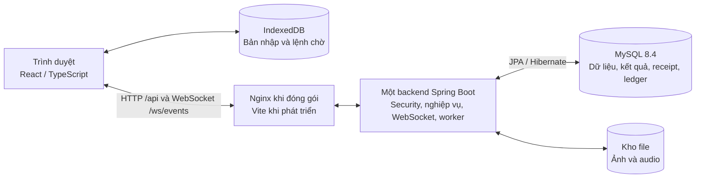

# English Learning — Hệ thống học và ôn luyện tiếng Anh

Bài tập lớn học phần **Lập trình mạng, PTIT, năm học 2026–2027**. English Learning là ứng dụng web theo mô hình client–server, kết hợp học theo lộ trình, ôn tập cá nhân, bài viết, phần thưởng và cuộc thi online. README được tổ chức theo yêu cầu tại [INSTRUCTION.md](INSTRUCTION.md), dành cho người nhận mã nguồn có thể tự cài đặt và chạy thử.

Hướng dẫn dưới đây áp dụng cho chuỗi database **Flyway V1–V18**. Các kết quả kiểm thử được ghi theo từng mốc trong mục 11; chúng không thay thế kiểm thử toàn bộ bản mã nguồn mới nhất.

## Mục lục

1. [Mô tả dự án](#1-mô-tả-dự-án)
2. [Kiến trúc và giao tiếp mạng](#2-kiến-trúc-và-giao-tiếp-mạng)
3. [Công nghệ sử dụng](#3-công-nghệ-sử-dụng)
4. [Yêu cầu môi trường](#4-yêu-cầu-môi-trường)
5. [Cài đặt và chạy nhanh](#5-cài-đặt-và-chạy-nhanh)
6. [Cấu hình](#6-cấu-hình)
7. [Thiết lập database và dữ liệu mẫu](#7-thiết-lập-database-và-dữ-liệu-mẫu)
8. [Chạy server](#8-chạy-server)
9. [Chạy client](#9-chạy-client)
10. [Kiểm thử](#10-kiểm-thử)
11. [Kết quả thực nghiệm](#11-kết-quả-thực-nghiệm)
12. [Điểm cải tiến và đóng góp](#12-điểm-cải-tiến-và-đóng-góp)
13. [Giới hạn và hướng phát triển](#13-giới-hạn-và-hướng-phát-triển)
14. [Tài liệu tham khảo](#14-tài-liệu-tham-khảo)
15. [Xử lý lỗi thường gặp](#15-xử-lý-lỗi-thường-gặp)

## 1. Mô tả dự án

Người học cần một quá trình liên tục từ học bài, lưu bài đang làm, xem kết quả đến ôn lại câu sai. Trong môi trường mạng, tải lại trang, mất phản hồi sau khi máy chủ đã ghi dữ liệu và thao tác từ nhiều tab có thể gây mất bản nhập, ghi đè hoặc nộp trùng. Dự án giải quyết các tình huống này bằng học liệu có phiên bản, transaction, kiểm soát revision, receipt chống xử lý trùng và lưu bản nhập tại trình duyệt.

| Vai trò | Chức năng chính |
|---|---|
| STUDENT | Học theo vòng, tiếp tục lượt dở, làm bốn dạng câu hỏi, nghe audio, dùng gợi ý/kiểm tra, nộp/chữa bài, ôn cá nhân, nộp bài viết, xem tiến độ/XP/bảng xếp hạng, tham gia cuộc thi |
| TEACHER | Biên soạn bài trong vòng được phân công, quản lý tài liệu/câu hỏi, gửi duyệt, chấm bài viết và xem thống kê theo quyền; ra đề/giám sát cuộc thi khi được cấp quyền riêng |
| ADMIN | Quản lý tài khoản, khóa và thu hồi phiên, giám sát hoạt động, quản lý lộ trình/phân công, duyệt học liệu/bộ đề, tổ chức và điều hành cuộc thi |

Đăng ký công khai luôn tạo STUDENT. Cuộc thi có lịch, check-in, hạn nộp và bảng xếp hạng riêng; kết quả thi không tự cộng XP, lịch ôn hoặc tiến độ vòng. Giải đấu XP theo tuần là một chức năng khác.

Sau khi chạy ứng dụng, có thể thử theo thứ tự:

1. Đăng nhập STUDENT → **Vào chơi** → vòng đang mở → chọn bài và bắt đầu làm.
2. Nhập đáp án, chuyển câu, tải lại trang để thử phục hồi; kiểm tra nhãn lưu tại máy và lưu trên máy chủ.
3. Nộp bài, xem kết quả/lời giải, xác nhận hoàn thành; vào **Ôn tập cá nhân** để chọn Tất cả, Ưu tiên hoặc Câu sai.
4. Đăng nhập TEACHER để biên soạn trong vòng được giao; ADMIN duyệt nội dung trước khi học viên sử dụng. Quy trình tại [Phân công và duyệt học liệu](docs/CONTENT_GOVERNANCE.md).
5. Thử [bài viết cuối vòng](docs/UNIT_WRITING.md) và [cuộc thi online](docs/ONLINE_CONTESTS.md). Muốn demo cuộc thi phải tạo/duyệt bộ đề, đặt lịch, duyệt học viên và check-in trước giờ thi; seed nền không tạo sẵn cuộc thi.

## 2. Kiến trúc và giao tiếp mạng



Backend phân lớp **Controller → Service interface/implementation → Repository interface/implementation → JPA**. Controller nhận DTO và principal; service kiểm tra quyền, transaction và nghiệp vụ; repository truy vấn/khóa/lưu. Không trả entity trực tiếp ra API.

### Giao thức và vòng đời kết nối

- **HTTP JSON `/api/*`:** đăng nhập, tải học liệu, lưu nháp, nộp bài và quản trị. File dùng multipart khi tải lên và HTTP Range khi đọc media. Trình phát trong lượt học/chữa bài chặn tua và giới hạn hai lượt bắt đầu nghe mỗi audio/Attempt; pause/nghe tiếp không trừ thêm, reload không hoàn lại lượt. Xem [chính sách nghe](docs/AUDIO_LISTENING_POLICY.md).
- **Phiên:** đăng nhập tạo cookie `JSESSIONID` HttpOnly/SameSite. Request thay đổi dữ liệu cần CSRF: lấy token/headerName từ `GET /api/auth/csrf`. Khi reload, client xác minh `GET /api/auth/me` trước khi phục hồi dữ liệu riêng.
- **WebSocket `/ws/events`:** handshake dùng phiên HTTP và allowlist origin. Server gửi CONNECTED; client gửi HELLO, chờ ACK, rồi đăng ký tài nguyên. Heartbeat mỗi 25 giây, cửa sổ hiện diện mặc định 75 giây; mất kết nối thì backoff 1–30 giây kèm jitter, đăng ký lại và GET đối soát.
- **Thu hồi:** logout, hết phiên hoặc khóa/đổi quyền làm mất hiệu lực phiên và đóng socket tương ứng. Mọi vai trò tự hết phiên sau 300 giây không tương tác, cảnh báo trước 30 giây. Heartbeat, autosave và audio tự phát không gia hạn tương tác.
- **Thông báo:** socket gửi invalidation sau commit, client GET lại dữ liệu. ACK socket không xác nhận đáp án đã lưu; không cộng XP từ event.

Ví dụ body `PUT /api/attempts/{id}/draft` cho một lượt có một câu; ID/revision phải lấy từ snapshot thật:

```json
{
  "requestId": "22a5ae67-d4b2-4fa8-b16f-0ff8617b4508",
  "baseRevision": 4,
  "answers": [{"attemptQuestionId": 1001, "response": null}],
  "playerState": {"currentAttemptQuestionId": 1001, "audioPositions": []}
}
```

Ví dụ message đăng ký thông báo cuộc thi sau HELLO ACK:

```json
{"version":1,"type":"SUBSCRIBE","requestId":"7f354d29-49bc-4480-b8c5-b8b505949cbe","resource":"CONTEST","contestId":123}
```

### Đồng thời, lưu dữ liệu và xử lý lỗi

Servlet container phục vụ nhiều request; transaction ghi khóa và kiểm tra actor trước tài nguyên nghiệp vụ. `baseRevision` phát hiện dữ liệu cũ; receipt theo actor/requestId nhận diện lệnh đã xử lý. Với lệnh có receipt, nghiệp vụ và receipt commit cùng transaction. Replay đúng key/payload trả kết quả cũ trước khi kiểm tra revision/state của lệnh mới. Submission/FIRST gốc giữ nguyên khi chữa bài.

Client lưu bản nhập vào IndexedDB (debounce 250 ms), autosave Attempt lên server sau 1.500 ms khi đủ điều kiện. Pending command giữ nguyên key/payload đến khi nhận và đối soát kết quả; generation ngăn ACK cũ ghi lên bản nhập mới. Bài thi có writer lease và deadline do server kiểm soát: reconnect không kéo dài giờ, hết hạn chỉ chốt phần đã commit trên server.

| Tình huống | Hành động |
|---|---|
| 400 — dữ liệu sai | Giữ bản nhập, hiển thị lỗi để sửa |
| 401 / 403 | Dừng gửi, xác minh lại phiên hoặc quyền |
| 404 — tài nguyên ngoài phạm vi | Không trả dữ liệu riêng của người khác |
| 409 — revision cũ | GET để đối chiếu, yêu cầu lựa chọn, không tự ghi đè |
| 409 — dùng lại requestId khác payload | Báo `REQUEST_ID_REUSED`, không tự đổi key rồi gửi lại mù |
| Timeout / mất mạng / 503 | Chưa biết đã commit hay chưa; giữ đúng lệnh chờ để replay và GET đối soát |
| Hết hạn cuộc thi | Không gửi bù đáp án chỉ lưu tại máy sau hạn |

Hợp đồng chi tiết: [M03](source/common/M02_M03_API.md), [M06](source/common/M06_API.md), [phiên/giám sát](source/common/ADMIN_SESSION_MONITORING_API.md), [cuộc thi](source/common/ONLINE_CONTESTS_API.md).

### Cấu trúc thư mục

```text
English-Learning-Project/
├── source/client/       React, CSS, adapter API, Playwright
├── source/server/       Spring Boot, Maven Wrapper, Flyway V1–V18, tests
├── source/common/       Hợp đồng API, OpenAPI và payload mẫu
├── scripts/             Khởi tạo/chạy, nạp dữ liệu, nghiệm thu
├── docs/                Kiến trúc, hướng dẫn chức năng, bàn giao
├── statics/dataset/     Học liệu và dữ liệu demo có thể chia sẻ
├── statics/results/     Biên bản kiểm thử và thực nghiệm theo mốc
├── report/              Tài liệu báo cáo môn học
├── compose.yml          MySQL + server + client, volume dữ liệu/file
├── compose.dev.yml      Mở cổng MySQL cho phát triển trên máy
├── .env.example         Mẫu cấu hình, không phải cấu hình bí mật thực tế
└── INSTRUCTION.md       Yêu cầu của học phần
```

## 3. Công nghệ sử dụng

| Thành phần | Công nghệ/framework/thư viện |
|---|---|
| Client | React 19.3.0, TypeScript 5.9.3, Vite 8.3.4 |
| Server | Java 17, Spring Boot 3.5.16, Spring Web, Spring Security, Validation, WebSocket |
| Dữ liệu | Spring Data JPA/Hibernate, MySQL Connector/J, MySQL 8.4, Flyway |
| Lưu tại trình duyệt | IndexedDB; Web Locks/lease để phối hợp khi có nhiều tab |
| Media | FFmpeg, ffprobe; file trong volume, metadata trong MySQL |
| Đóng gói | Docker Compose, Nginx; image build dùng Maven 3.9 và Node.js 24 |
| Kiểm thử | JUnit/Spring Test, Mockito, Testcontainers MySQL, Playwright 1.64.0, harness Node.js |

Phiên bản dependency được khai báo tại [package.json](source/client/package.json), [package-lock.json](source/client/package-lock.json) và [pom.xml](source/server/pom.xml). Dự án sử dụng các framework/giao thức có sẵn, không tự triển khai HTTP/WebSocket ở mức TCP.

## 4. Yêu cầu môi trường

| Cách chạy | Cần cài trên máy |
|---|---|
| Chạy toàn bộ bằng Docker, khuyến nghị | Git nếu clone từ GitHub; Docker Desktop/Engine đang chạy, Linux containers, Compose V2 hỗ trợ `--wait`; trình duyệt hiện đại |
| Server trực tiếp | JDK 17, Maven Wrapper có sẵn, FFmpeg và ffprobe trên PATH, MySQL 8.4 (có thể chạy bằng Docker) |
| Client hoặc script Node trực tiếp | Node.js 24 khuyến nghị; package yêu cầu tối thiểu 22.12.0; npm |
| Backend integration tests | JDK, FFmpeg/ffprobe và Docker hoạt động để Testcontainers tạo MySQL riêng |
| Browser tests | Node/npm, Docker và Chromium của Playwright hoặc trình duyệt chỉ định bằng `PLAYWRIGHT_CHROMIUM_EXECUTABLE_PATH` |

Cần Internet trong lần đầu tải Docker image, Maven dependencies, npm packages và Chromium. Các cổng mặc định là **5173** (giao diện), **8080** (API), **3306** (chỉ khi mở MySQL cho phát triển). Docker phải có đủ RAM/dung lượng cho MySQL, build và container test; dự án chưa xác định cấu hình phần cứng tối thiểu bằng phép đo.

## 5. Cài đặt và chạy nhanh

### Windows / PowerShell

Mở Docker Desktop, chờ engine sẵn sàng. Nếu nhận file ZIP, giải nén rồi mở terminal tại thư mục có `compose.yml`; nếu lấy từ GitHub:

```powershell
git clone https://github.com/BrokenDev375/English-Learning-Project.git
cd English-Learning-Project
```

Chạy toàn bộ:

```powershell
.\start.cmd
```

Script tạo `.env` từ mẫu nếu chưa có, sinh mật khẩu database/admin, sau đó build và chạy ba service. Có thể thực hiện tương đương từng bước:

```powershell
powershell -ExecutionPolicy Bypass -File scripts/init-env.ps1
docker compose up -d --build --wait
docker compose ps
Invoke-RestMethod http://localhost:8080/api/health
```

Chỉ tiếp tục khi Compose thành công. Mở **http://localhost:5173**. Kiểm tra health trả trạng thái `UP`; với demo mới, chờ log `M02 curriculum seed completed:` trước khi thử bài mẫu:

```powershell
docker compose logs --tail 100 server
```

### Linux / macOS

Cần Docker Compose và `openssl`. Từ thư mục gốc:

```sh
sh scripts/start.sh
docker compose ps
curl http://localhost:8080/api/health
```

### Tài khoản lần chạy đầu

| Vai trò | Email theo mẫu cấu hình | Mật khẩu |
|---|---|---|
| ADMIN | `admin@english.local` | Xem `BOOTSTRAP_ADMIN_PASSWORD` trong `.env` trên chính máy đang chạy |
| TEACHER | `teacher@english.local` | Xem `DEMO_TEACHER_PASSWORD` trong `.env` |
| STUDENT | `student@english.local` | Xem `DEMO_STUDENT_PASSWORD` trong `.env`, hoặc tự đăng ký tài khoản mới |

Tài khoản demo cần `DEMO_ENABLED=true`; tạo admin ban đầu cần `BOOTSTRAP_ADMIN_ENABLED=true` (script dùng mẫu đã bật hai giá trị này). Bootstrap chỉ tạo tài khoản chưa tồn tại, không đổi mật khẩu/quyền hoặc mở khóa tài khoản đã có khi restart. Đổi `.env` không đồng nghĩa đổi mật khẩu trong DB.

Để dừng và chạy lại từ thư mục gốc:

```powershell
docker compose stop
docker compose up -d --build --wait
```

Sau khi đổi nhánh/mã nguồn, dùng `--build` để chạy đúng code mới; xem lưu ý lịch sử migration ở mục 7 trước khi dùng DB cũ.

## 6. Cấu hình

File [.env.example](.env.example) mô tả các biến dùng cho local. Script khởi tạo không ghi đè `.env` đã có. Không chia sẻ/commit `.env`, backup chứa dữ liệu riêng hoặc auth trace.

| Biến | Giá trị/ý nghĩa |
|---|---|
| `MYSQL_DATABASE`, `MYSQL_USER` | Mặc định `english_learning`, `english_app` |
| `MYSQL_PASSWORD`, `MYSQL_ROOT_PASSWORD` | Script sinh riêng khi tạo `.env`; Compose yêu cầu có giá trị |
| `APP_PORT`, `API_PORT`, `MYSQL_PORT` | Mặc định 5173, 8080, 3306; `MYSQL_PORT` chỉ dùng với `compose.dev.yml` |
| `BOOTSTRAP_ADMIN_ENABLED/EMAIL/PASSWORD` | Cho phép tạo admin đầu tiên và thông tin tài khoản |
| `DEMO_ENABLED` | Bật tạo tài khoản/học liệu demo; local mới mặc định bật theo mẫu |
| `DEMO_TEACHER_EMAIL/PASSWORD`, `DEMO_STUDENT_EMAIL/PASSWORD` | Tài khoản demo trên DB mới |
| `SESSION_COOKIE_SECURE` | `false` khi chạy HTTP local; dùng `true` khi triển khai HTTPS |
| `WS_ALLOWED_ORIGINS` | Danh sách origin phân cách dấu phẩy; mặc định `http://localhost:5173,http://127.0.0.1:5173` |
| `WS_PRESENCE_TIMEOUT_MS`, `WS_SWEEP_MS` | 75000 và 5000 ms; liveness/sweep kết nối |
| `SESSION_IDLE_TIMEOUT_SECONDS`, `SESSION_IDLE_WARNING_SECONDS`, `SESSION_IDLE_SWEEP_MS` | 300 giây, 30 giây, 5000 ms; deadline không tương tác/cảnh báo/sweep |

Nếu đổi `APP_PORT`, phải đổi `WS_ALLOWED_ORIGINS` theo origin giao diện. Dùng nhất quán `localhost` hoặc `127.0.0.1` khi đăng nhập và thử phục hồi vì cookie/storage được trình duyệt phân tách theo origin.

Các biến **chạy server trực tiếp**: `DB_URL`, `DB_USERNAME`, `DB_PASSWORD`, `SERVER_PORT`, `ASSET_DIRECTORY`, `MEDIA_PROBE_EXECUTABLE`. Compose tự ánh xạ MySQL sang ba biến DB và đặt kho file `/app/data/assets`; không cần đặt `DB_URL` trong `.env` cho cách chạy Docker mặc định. Biến môi trường của terminal có thể ghi đè giá trị `.env` khi Compose nội suy.

## 7. Thiết lập database và dữ liệu mẫu

### Database mới

Không cần cài MySQL trên host hoặc nhập SQL thủ công khi chạy toàn bộ bằng Docker. Container MySQL tạo database/user từ cấu hình ở lần khởi tạo volume đầu tiên. Khi server khởi động, Flyway tự chạy migration còn thiếu; Hibernate dùng `ddl-auto=validate`.

| Nhóm migration | Dữ liệu chính |
|---|---|
| V1–V4 | Tài khoản/quản trị, học liệu có phiên bản, lượt làm, trial, Submission, tiến độ, receipt |
| V5–V8 | Ôn tập, thưởng/ledger/outbox, giải đấu tuần |
| V9–V12 | ORDERING, chính sách cấp độ/giải đấu, số vòng |
| V13–V15 | Phân công/duyệt học liệu, cấu trúc hoạt động bài học, bài viết cuối vòng |
| V16–V17 | Cuộc thi, thư viện bộ đề và quyền ra đề/giám sát |
| V18 | Bộ đếm lượt nghe theo Attempt/MaterialVersion |

Khi bật demo trên DB mới, seed nền tạo **3 Unit, 6 Lesson, 90 Question, 13 Material**. Mỗi bài có 5 GUIDED, 5 INDEPENDENT và 5 REVIEW_VARIANT. Seed có checkpoint/seedKey để khởi động lại; không tự tạo điểm/XP hoặc lịch thi cho người học. Nguồn học liệu tại [statics/dataset](statics/dataset/README.md).

### Dữ liệu bổ sung, không bắt buộc

Từ thư mục gốc, với Node.js đã cài, kiểm tra bộ câu hỏi chia sẻ mà chưa ghi vào ứng dụng:

```powershell
node scripts/seed-demo-questions.mjs
```

Muốn nạp qua API vào đúng DB local đã chọn:

```powershell
node scripts/seed-demo-questions.mjs --base-url http://localhost:5173 --apply
```

Lệnh `--apply` tạo thêm nội dung bằng ADMIN cấu hình trên máy; chỉ chạy khi muốn thêm dữ liệu. Có ba chủ đề A1–A2, mỗi chủ đề 20 câu học + 4 câu ôn và bộ đề thi 20 câu, chưa có audio/ảnh. Giữ checkpoint cùng DB để tiếp tục khi gián đoạn. Xem [hướng dẫn đầy đủ và môi trường demo riêng](docs/DEMO_QUESTION_DATA.md). Không chạy script `seed-demo-classroom.mjs --apply` cũ vì chưa tương thích quy trình duyệt V13.

### Lưu trữ, nâng cấp và sao lưu

Compose mặc định dùng project `english-learning-project`, named volumes `mysql_data` cho MySQL và `asset_data` cho file; Docker đặt tiền tố project cho tên volume thực tế. `stop` hoặc `down` thông thường giữ volume. **Không dùng `down -v` để cập nhật code** vì sẽ xóa volume và dữ liệu.

Sao lưu cả MySQL và kho file trước khi nâng DB đang có dữ liệu. Không sửa migration đã áp dụng, tự `repair` hoặc dùng `ddl-auto=create/update` để xử lý lỗi lịch sử. DB theo main V17 nâng bằng V18; DB từng chạy **V14 audio của nhánh admin cũ**, hoặc activities mang số migration cũ, cần chuyển đổi lịch sử riêng trên bản sao. Xem [hướng dẫn tích hợp](docs/ADMIN_MAIN_INTEGRATION.md) và [các DB baseline](docs/BASELINE_TESTING.md).

Đổi `MYSQL_PASSWORD` trong `.env` không đổi mật khẩu MySQL của volume đã khởi tạo. Session/socket nằm trong RAM, restart server có thể yêu cầu đăng nhập lại; dữ liệu đã commit trong MySQL/file volume vẫn còn.

## 8. Chạy server

### Bằng Docker

Từ thư mục gốc sau khi có `.env`:

```powershell
docker compose up -d --build --wait server
docker compose logs -f server
```

Lệnh tự khởi động dependency MySQL, API mặc định **http://localhost:8080/api/health**. Nhấn `Ctrl+C` chỉ thoát theo dõi log.

### Chạy trực tiếp để phát triển trên Windows

Chọn cách này khi muốn debug backend bằng IDE/Maven. Cần JDK 17, `ffmpeg`, `ffprobe`; không chạy đồng thời server Docker trên cùng cổng. Từ **thư mục gốc**, sau khi tạo `.env`, dừng server/client Docker mặc định rồi mở MySQL cho host:

```powershell
docker compose stop client server
docker compose -p english-learning-native -f compose.yml -f compose.dev.yml up -d --wait mysql

# Nạp mẫu KEY=VALUE của .env vào tiến trình hiện tại, không in giá trị.
# Đoạn này dùng cho định dạng đơn giản trong .env.example, không phải parser dotenv tổng quát.
Get-Content -LiteralPath .env | ForEach-Object {
    if ($_ -match '^([A-Za-z_][A-Za-z0-9_]*)=(.*)$') {
        [Environment]::SetEnvironmentVariable($matches[1], $matches[2], 'Process')
    }
}
$env:DB_USERNAME = $env:MYSQL_USER
$env:DB_PASSWORD = $env:MYSQL_PASSWORD
$env:DB_URL = "jdbc:mysql://127.0.0.1:$($env:MYSQL_PORT)/$($env:MYSQL_DATABASE)?connectionTimeZone=UTC&forceConnectionTimeZoneToSession=true&useUnicode=true&characterEncoding=UTF-8"
$env:SERVER_PORT = $env:API_PORT
$env:ASSET_DIRECTORY = Join-Path (Get-Location).Path '.test-state/native-assets'

Set-Location source/server
.\mvnw.cmd spring-boot:run
```

Server native không tự đọc `.env`; vì vậy cần bước nạp biến hoặc cấu hình tương đương trong IDE. Ví dụ dùng project **`english-learning-native` với volume MySQL riêng**, seed sẽ tạo file vào `.test-state/native-assets` ở lần chạy đầu. Kho này khác volume `asset_data` của bản chạy Docker; không trộn DB/kho file rồi kỳ vọng ảnh/audio cũ tự xuất hiện. Nếu một MySQL khác đã mở cổng 3306, đổi `MYSQL_PORT` trong `.env` trước khi thực hiện. Trên Linux/macOS, cấp các biến tương đương rồi chạy `./mvnw spring-boot:run` trong `source/server`.

## 9. Chạy client

### Bằng Docker

Từ thư mục gốc, sau khi khởi tạo cấu hình:

```powershell
docker compose up -d --build --wait client
```

Client được build thành file tĩnh, Nginx phục vụ ở **http://localhost:5173** và proxy tới backend. Lệnh khởi động cả dependency server/MySQL.

### Bằng Vite để phát triển

Server phải chạy trước. Mở terminal khác tại thư mục gốc:

```powershell
docker compose stop client
Set-Location source/client
npm ci
$env:API_PROXY_TARGET = 'http://127.0.0.1:8080'
npm run dev
```

Mở **http://localhost:5173**. Vite proxy `/api` và `/ws` đến `API_PROXY_TARGET`; đổi biến nếu backend dùng cổng khác. Nếu đổi cổng Vite bằng `npm run dev -- --port 5177`, phải thêm origin đó vào `WS_ALLOWED_ORIGINS` và khởi động lại backend với cấu hình mới.

Kiểm tra bản build production bằng `npm run build` trong `source/client`. Để chạy bản đóng gói đầy đủ với Nginx và các dependency, dùng Docker Compose như hướng dẫn ở trên.

## 10. Kiểm thử

Những lệnh dưới đây là cách tái hiện kiểm thử, không có nghĩa tất cả đã được chạy lại ở lần cập nhật README. Kiểm thử có ghi dữ liệu phải dùng môi trường riêng.

### Backend

Docker phải hoạt động để Testcontainers tạo MySQL riêng; JDK và công cụ media cần sẵn sàng:

```powershell
cd source/server
.\mvnw.cmd test
```

Chạy nhóm tập trung nếu cần:

```powershell
.\mvnw.cmd '-Dtest=AttemptApiTest,AttemptPersistenceTest,ContestApiTest,ContestPaperApiTest,WritingApiTest' test
```

Kết quả JUnit tại `source/server/target/surefire-reports/`. Không đặt cấu hình test trỏ vào DB demo; các integration tests dùng MySQL Testcontainers.

### Client và harness phục hồi

Từ `source/client`:

```powershell
npm ci
npm run build
npm run test:connection
npm run test:session
npx playwright install chromium
npm run test:recovery-storage
```

Harness connection/session kiểm tra logic bằng clock/transport kiểm soát; storage chạy IndexedDB trong trình duyệt thật. Có thể đặt `$env:PLAYWRIGHT_CHROMIUM_EXECUTABLE_PATH` tới file Chrome/Chromium nếu không dùng bản Playwright tải về.

### End-to-end bằng Playwright

Cần `.env` hợp lệ ở root, Docker và dependency/browser đã cài. Trong terminal kiểm thử, từ `source/client`:

```powershell
# Không kế thừa URL ứng dụng thật từ lần chạy trước.
Remove-Item Env:E2E_BASE_URL -ErrorAction SilentlyContinue
npm run test:e2e
```

Runner tự build/chạy project **`english-learning-e2e`**, frontend **5174**, API **8081**, volume riêng, chờ seed rồi chạy test. Xong sẽ dừng container, giữ volume để chẩn đoán. Chạy riêng nhóm:

```powershell
npm run test:e2e -- e2e/audio-listening.spec.ts e2e/online-contests.spec.ts --workers=1
```

Đổi môi trường/cổng bằng `E2E_PROJECT_NAME` (tiền tố `english-learning-e2e-`), `E2E_APP_PORT`, `E2E_API_PORT`. Nếu chủ động đặt `E2E_BASE_URL`, runner dùng URL đó và **không tạo môi trường riêng**; chỉ dùng cách này với ứng dụng dành riêng cho test. Các test tạo/sửa/thu hồi nội dung, không trỏ vào DB đang dùng học/demo. Báo cáo tại `source/client/playwright-report/` và `test-results/`.

Các ca idle đặc biệt cần cấu hình riêng; xem [bàn giao giám sát phiên](docs/ADMIN_SESSION_MONITORING_HANDOFF.md). Không giảm timeout của bản demo chỉ để chạy test nhanh.

### Nghiệm thu độ bền và workload

| Chạy từ | Lệnh | Nội dung |
|---|---|---|
| `source/client` | `node scripts/verify-m03-persistence.mjs` | Restart/recreate, nháp/kết quả/replay/seed/media; project riêng, cổng 5175/8082 |
| `source/client` | `npm run test:session-acceptance` | Phiên, phục hồi và các tình huống nghiệm thu; xem cấu hình trong tài liệu bàn giao |
| Root | `node scripts/verify-m05-acceptance.mjs` | Ledger/backlog/replay/restart và workload M05; project riêng, cổng 15177/18084 |
| Root | `node --test --test-isolation=none scripts/seed-demo-questions.test.mjs` | Kiểm tra script nạp bộ câu hỏi |

Các script nghiệm thu cần Docker, `.env` hợp lệ và dependencies frontend. Kiểm tra cổng/tài nguyên trước khi chạy; giữ báo cáo của lần chạy mới riêng, không ghi đè kết luận lịch sử. Quy trình chi tiết ở [M03](docs/M03_MANUAL_TEST_CASES.md), [M05](docs/M05_HANDOFF.md), [M06](docs/M06_MANUAL_TEST_CASES.md).

## 11. Kết quả thực nghiệm

### Bằng chứng kiểm thử đã ghi nhận

| Phạm vi và ngày | Kết quả | Giới hạn và nguồn |
|---|---|---|
| Tích hợp main + giám sát phiên, 31/10/2026; nền `7c171f1` + `fe3ab0c` | 132 ca backend khác nhau qua nhiều lượt; 42 ca browser khác nhau qua ba lượt; manager 14/14, tracker 11/11, storage 6/6; build đạt | Lượt backend đầu 130/132, hai ca fixture chạy lại 2/2; browser đầu 32/33, sửa kỳ vọng player rồi chạy lại 1/1, thêm 9 ca idle. **Không phải một lượt 132/132 hoặc 42/42.** [Biên bản](statics/results/admin-main-integration-validation.md) |
| Kho bộ đề V17, 30/10/2026 | Backend 117/117 trong một lượt; browser luồng mới 5/5; manager 12/12 | Trước các sửa và tích hợp sau đó. [Biên bản](statics/results/contest-paper-library-validation.md) |
| Tích hợp ôn tập/bài viết, 30/10/2026 | Backend lượt đầu 98/99, ca Origin chạy lại 1/1; browser 33/33, storage 6/6 | Hồi quy tập trung; không phải một lượt backend 99/99. [Biên bản](statics/results/addquestion-main-integration-validation.md) |

Các suite có thể trùng ca, **không cộng các hàng thành tổng kiểm thử**. Chưa có bằng chứng một lượt hồi quy toàn bộ sau mọi commit của bản bàn giao; thay đổi README này không chạy lại các suite ứng dụng.

### Workload local M05 ngày 22/10/2026

Nguồn nền `57f2951`, working tree M05 trước commit. Một backend, Docker được cấp **12 CPU và 8.011.960.320 byte RAM**; 20 học viên giả lập, mỗi người 2 WebSocket và 6 lượt PRACTICE tuần tự. Worker xử lý thưởng mặc định, không gọi manual sync trong pha đo. Cấu hình CPU host và topology mạng chưa được ghi đầy đủ.

| Chỉ số | Giá trị ghi nhận |
|---|---:|
| Học viên / WebSocket / Submission | 20 / 40 / 120 |
| HTTP submit ACK p50 / p95 | 503 ms / 951 ms |
| Pha tạo/nộp đến ACK cuối | 10 764 ms |
| Từ ACK cuối đến kiểm tra backlog rỗng | 3 970 ms |
| Invalidation nhận trong cửa sổ đo | 1 040 |
| Sai lệch ledger trong mẫu audit | 0 |

Nguồn: [biên bản M05](statics/results/module-5-validation.md). ACK nộp bài và hoàn tất thưởng là hai mốc khác nhau; số invalidation không bằng số phần thưởng. Pha tạo/nộp có cả tạo Attempt, nên không lấy 120 chia thời gian pha để gọi là throughput riêng của submit. Đây là workload hữu hạn local, chưa phải đo sức tải tối đa, tải cuộc thi hoặc hiệu năng bản main hiện tại; chưa đủ kết luận cải thiện năng lực tiếng Anh.

## 12. Điểm cải tiến và đóng góp

Đóng góp tập trung vào thiết kế và tích hợp quy tắc nghiệp vụ với xử lý lỗi mạng, không tuyên bố một giao thức hay thuật toán mới trên thế giới. Mốc đối chiếu là những cách triển khai đơn giản nêu trong bảng, chưa phải một baseline đã được chạy thực nghiệm đối chứng.

| Cách triển khai đơn giản dùng để đối chiếu | Cải tiến của dự án | Bằng chứng |
|---|---|---|
| Gửi lại lệnh sau timeout có nguy cơ ghi lặp | Receipt và nghiệp vụ cùng transaction; giữ key/payload, replay rồi GET đối soát | [API M03](source/common/M02_M03_API.md), [nghiệm thu tích hợp](statics/results/admin-main-integration-validation.md) |
| Chỉ giữ bản nhập trong state trình duyệt | IndexedDB/journal, generation chống ACK cũ, phát hiện revision xung đột và phục hồi sau hết phiên | [thiết kế M06](source/common/M06_API.md), [kiểm tra tích hợp](statics/results/admin-main-integration-validation.md) |
| Đọc nội dung hiện hành và ghi đè kết quả khi chữa | Chốt phiên bản theo lượt, tách FIRST/đáp án cuối/CORRECTION, giữ Submission gốc | [hợp đồng M03](source/common/M02_M03_API.md), [nghiệm thu M03](statics/results/module-3-validation.md) |
| Soạn đề gắn cứng với từng cuộc thi và quyền giáo viên chung | Kho đề được duyệt/dùng lại, snapshot riêng, quyền tác giả/giám thị độc lập; deadline và writer do server kiểm soát | [thiết kế cuộc thi](docs/ONLINE_CONTESTS.md), [kiểm tra V17](statics/results/contest-paper-library-validation.md) |
| Đếm nghe chỉ ở giao diện, mất bộ đếm khi reload | Bộ đếm server theo Attempt/MaterialVersion, tối đa hai lượt, transaction/receipt chống trừ lặp | [chính sách audio](docs/AUDIO_LISTENING_POLICY.md), [kiểm tra V18](statics/results/admin-main-integration-validation.md) |

IOE và Duolingo được tham khảo về tự luyện/thi và động lực học tập; dự án chưa có nghiên cứu đối chứng để kết luận tốt hơn hai sản phẩm này. Nguồn khảo sát ở mục 14.

## 13. Giới hạn và hướng phát triển

- Một backend; session và registry socket ở RAM. Chưa có session phân tán hoặc phát invalidation giữa nhiều backend; restart có thể phải đăng nhập lại.
- IndexedDB phụ thuộc trình duyệt, quota và commit. Chưa có PWA, đăng nhập offline hoặc tải trước toàn bộ media; dữ liệu chưa commit có thể mất. Khi hết hạn thi, đáp án chỉ lưu local không được gửi bù.
- Presence và trạng thái tab có độ trễ do heartbeat/throttle. Rời tab chỉ là tín hiệu giám sát, không chứng minh gian lận; chặn tua/giới hạn nghe trong luồng ứng dụng không phải DRM chống trình duyệt bị sửa.
- Kho đề thi hiện bốn dạng tự chấm, context chữ; chưa nối file nghe/ảnh hoặc bài nói/tự luận. Bài viết cuối vòng chấm tay theo tiêu chí đạt/chưa đạt, chưa có điểm một phần.
- Chưa có luyện nói, ghi âm và chấm phát âm. Hướng phát triển là ghi âm/nghe lại và nhận xét giáo viên trước, sau đó nghiên cứu nhận dạng tiếng nói và đánh giá phát âm có kiểm chứng.
- Chưa có khôi phục mật khẩu qua email và rate limiting đăng nhập; cấu hình local HTTP/tài khoản demo không phải cấu hình triển khai công khai hoàn chỉnh.
- Dataset nhỏ, mức A1–A2 chưa được chuẩn hóa; chưa nghiên cứu trên người học thật, chưa có capacity test cho cuộc thi hoặc phép đo thống nhất trên bản cuối.

Ưu tiên tiếp theo: hồi quy thống nhất trên mã nguồn chốt; lặp workload ở nhiều mức tải và độ trễ mạng; mở rộng học liệu; nghiên cứu triển khai nhiều backend khi có nhu cầu và bằng chứng đo lường.

## 14. Tài liệu tham khảo

### Tài liệu và bằng chứng trong repository

- [Yêu cầu học phần](INSTRUCTION.md); [bản đồ mã nguồn](AGENTS.md).
- [API học/lượt làm và OpenAPI liên quan](source/common/M02_M03_API.md), [API ôn tập](source/common/M04_API.md), [API phần thưởng](source/common/M05_API.md), [API thống kê](source/common/M07_API.md).
- [Kết nối/phục hồi](source/common/M06_API.md), [giám sát phiên](source/common/ADMIN_SESSION_MONITORING_API.md), [chính sách nghe](docs/AUDIO_LISTENING_POLICY.md).
- [Phân công/duyệt học liệu](docs/CONTENT_GOVERNANCE.md), [bài viết cuối vòng](docs/UNIT_WRITING.md), [cuộc thi và kho đề](docs/ONLINE_CONTESTS.md).
- [Nguồn học liệu](statics/dataset/README.md), [bộ câu hỏi chia sẻ](docs/DEMO_QUESTION_DATA.md), [kiểm tra bộ dữ liệu](statics/results/demo-question-data-validation.md).
- Các biên bản tại [statics/results](statics/results/) ghi rõ phạm vi, ngày, kết quả và giới hạn; đây là hồ sơ nội bộ của nhóm.

### Giao thức, framework và sản phẩm tham khảo

- [RFC 9110 — HTTP Semantics](https://www.rfc-editor.org/rfc/rfc9110.html): ngữ nghĩa HTTP và tính lũy đẳng.
- [RFC 6455 — The WebSocket Protocol](https://www.rfc-editor.org/rfc/rfc6455.html): handshake và giao tiếp hai chiều.
- [Spring Security — Session Management](https://docs.spring.io/spring-security/reference/6.5/servlet/authentication/session-management.html): quản lý xác thực bằng phiên.
- [Docker Compose](https://docs.docker.com/compose/): mô tả/chạy các service, mạng và volume.
- [IOE — Hướng dẫn tham gia năm học 2025–2026](https://ioe.vn/chi-tiet/tin-tu-ban-to-chuc/huong-dan-tham-gia-ioe-nam-hoc-20252026-1-7341): tham khảo tổ chức tự luyện và thi.
- [Duolingo — Time Spent Learning Well](https://blog.duolingo.com/time-spent-learning-well/): tham khảo cách nhìn nhận hoạt động học và động lực.

## 15. Xử lý lỗi thường gặp

| Triệu chứng | Kiểm tra và cách xử lý |
|---|---|
| Docker daemon chưa sẵn sàng | Mở Docker Desktop, kiểm tra `docker info`, chờ engine rồi chạy lại |
| `lookup registry-1.docker.io: no such host` khi build | Lỗi DNS/kết nối tới registry trước khi build code. Kiểm tra mạng/DNS/VPN/proxy của Docker Desktop, thử `docker pull node:24-alpine`, rồi build lại |
| Cổng 5173/8080/3306 bị chiếm | Dừng đúng tiến trình/stack đang dùng hoặc đổi cổng và origin theo mục 6; không xóa volume để giải phóng cổng |
| API chưa UP / seed chưa hoàn tất | Xem `docker compose ps`, `docker compose logs --tail 100 mysql server`; sửa nguyên nhân trong log rồi chạy lại |
| Sai mật khẩu sau khi đổi `.env` | DB cũ không tự cập nhật mật khẩu tài khoản/MySQL theo file mới. Xác định đúng project, volume và cấu hình đã khởi tạo |
| Flyway checksum/version mismatch | Dừng việc nâng DB đó, sao lưu và đối chiếu chuỗi migration; xem mục 7. Không reset/repair mù |
| HTTP chạy nhưng WebSocket lỗi | Kiểm tra origin thực tế trong `WS_ALLOWED_ORIGINS`, proxy `/ws`, cookie và phiên hiện hành; rebuild/restart với cấu hình đúng |
| Hết phiên dù tab vẫn mở hoặc audio vẫn phát | Không tương tác 5 phút là hành vi mặc định; dùng cảnh báo Tiếp tục làm việc hoặc đăng nhập lại để khôi phục nháp đúng user |
| Audio/ảnh mất khi chạy native | Kiểm tra `ASSET_DIRECTORY` có đúng kho file tương ứng với metadata DB không; kiểm tra quyền file và công cụ media |
| Chromium chưa cài / không khởi chạy test | Chạy `npx playwright install chromium` tại client hoặc cấu hình đường dẫn browser hợp lệ |

Khi cần kiểm tra phiên bản đang chạy, ghi lại `git rev-parse --short HEAD`, project Compose, cổng và log lỗi đã che thông tin nhạy cảm. Các cổng demo lịch sử trong tài liệu module không thay thế cổng mặc định của hướng dẫn này.
