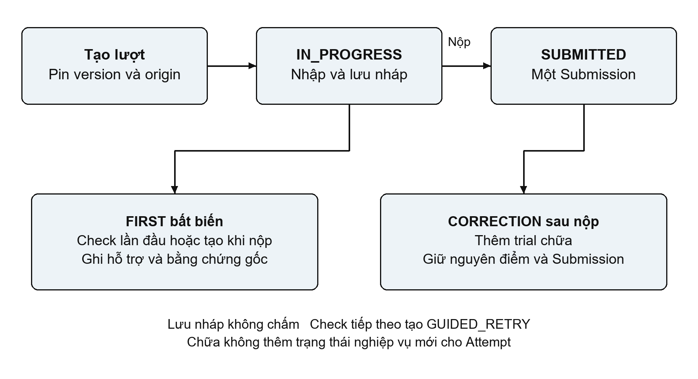
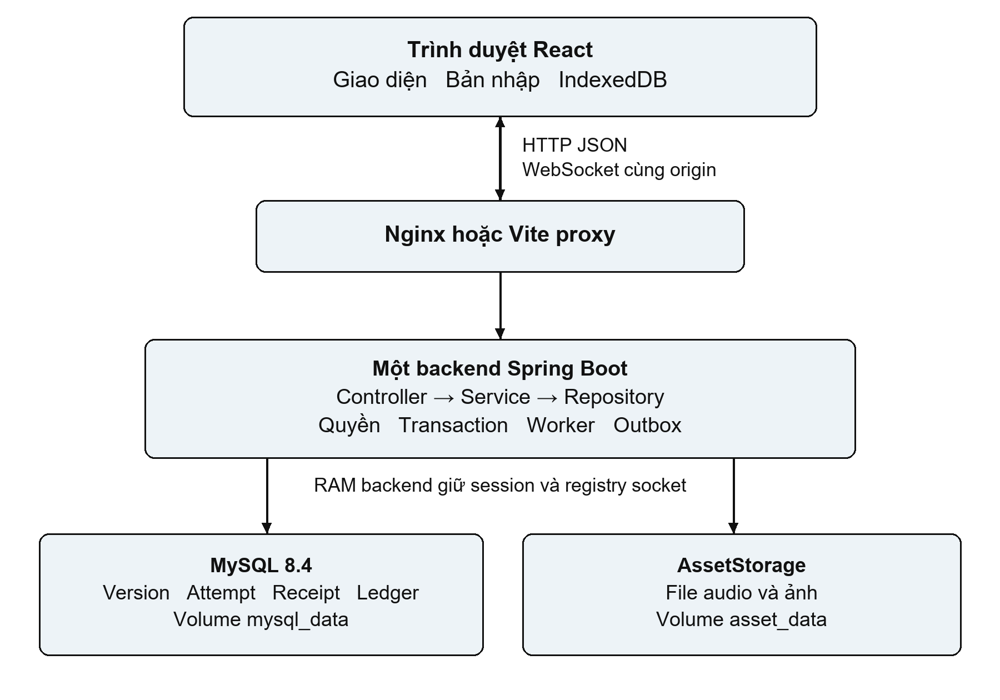
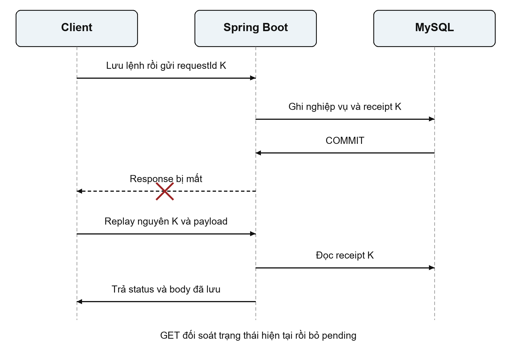

# English Learning

Ứng dụng học tiếng Anh theo mô hình Client Server với cơ chế lưu và phục hồi lượt học

HỌC VIỆN CÔNG NGHỆ BƯU CHÍNH VIỄN THÔNG

BÁO CÁO BÀI TẬP LỚN MÔN LẬP TRÌNH MẠNG

Năm học 2026–2027

Nhóm: ____________________

Lớp: ____________________

Giảng viên hướng dẫn: ____________________

Sinh viên thực hiện và MSSV: ____________________

Tháng 10 năm 2026

## Tóm tắt

English Learning là ứng dụng học tiếng Anh theo mô hình client–server, hỗ trợ biên soạn học liệu có phiên bản, học và ôn tập, lưu nháp, nộp bài, xem kết quả, phần thưởng và thống kê theo quyền. Bài toán kỹ thuật của hệ thống là duy trì trạng thái lượt học nhất quán khi trình duyệt và máy chủ có thể mất kết nối, phản hồi đến muộn hoặc nhiều tab cùng thao tác. Giải pháp kết hợp HTTP/JSON cho nghiệp vụ với WebSocket cho heartbeat và thông báo thay đổi; sử dụng transaction, khóa hàng, revision và request receipt để xử lý ghi đồng thời và gửi lại; lưu bản nhập cùng lệnh chờ trong IndexedDB để phục hồi và đối soát. Các phiên bản câu hỏi được chốt khi tạo lượt, còn kết quả nộp và bằng chứng lần đầu được giữ bất biến. Hệ thống triển khai bằng React, Spring Boot và MySQL, đóng gói bằng Docker Compose. Trong workload local M05 ngày 22/10/2026, 20 học viên giả lập mở 40 socket và tạo 120 bài nộp; thời gian nhận ACK submit p50 là 503 ms, p95 là 951 ms và không phát hiện sai lệch ledger trong các kiểm tra đã ghi nhận. Kết quả này mô tả một phép đo hữu hạn trên một backend, chưa đại diện cho sức tải cực đại hoặc hiệu năng của mọi thay đổi sau đó. Đóng góp của dự án nằm ở sự phối hợp giữa giao thức thao tác, bảo toàn dữ liệu và phục hồi lượt học, được kiểm chứng bằng các kịch bản replay, conflict, reload và restart có phạm vi xác định.

## Từ khóa

Client–Server; HTTP/REST; WebSocket; Idempotency; Concurrency; Fault tolerance.

## Mục lục

1. Giới thiệu
2. Cơ sở kỹ thuật và các giải pháp liên quan
3. Định nghĩa bài toán và yêu cầu hệ thống
4. Giải pháp đề xuất
5. Kiến trúc hệ thống
6. Thiết kế giao tiếp mạng
7. Triển khai hệ thống
8. Thiết lập và phương pháp thực nghiệm
9. Kết quả
10. Thảo luận
11. Đóng góp kỹ thuật
12. Hạn chế
13. Hướng phát triển
14. Kết luận
15. Tài liệu tham khảo
16. Phụ lục

## 1 Giới thiệu

### 1.1 Bối cảnh và vấn đề

Một phiên học tiếng Anh qua mạng có nhiều thao tác trước lần nộp cuối: nhập từng câu trả lời, nghe lại audio, mở gợi ý, kiểm tra câu hướng dẫn, tạm dừng và tiếp tục. Nếu hệ thống chỉ lưu trạng thái giao diện trong bộ nhớ trình duyệt, đóng hoặc tải lại trang có thể làm mất dữ liệu. Nếu chỉ lưu tại máy chủ sau mỗi request, người dùng vẫn có thể gặp trạng thái không rõ khi request đã commit nhưng response bị mất. Việc gửi lại một yêu cầu nộp cũng có thể tạo hiệu ứng lặp nếu máy chủ không nhận diện được thao tác logic ban đầu.

Vấn đề còn xuất hiện khi người học mở nhiều tab hoặc tác giả cập nhật học liệu trong lúc lượt học đang diễn ra. Một tab có revision cũ không được tự động ghi đè đáp án mới hơn. Câu hỏi đã được cấp cần giữ nội dung và đáp án của phiên bản lúc tạo lượt. Sau khi xem lời giải, việc chữa bài có giá trị học tập nhưng không được sửa ngược bằng chứng trả lời lần đầu hoặc điểm đã ghi nhận. Những yêu cầu này gắn chức năng giáo dục với các bài toán giao tiếp, đồng thời và quản lý trạng thái của môn Lập trình mạng.

### 1.2 Mục tiêu

Dự án xây dựng một ứng dụng mạng có phân vai rõ giữa client và server; cung cấp vòng học từ học liệu công bố đến lưu, nộp, chữa và theo dõi tiến độ; giữ được dữ liệu đã xác nhận qua những tình huống phục hồi đã kiểm tra. Các thao tác ghi cần kiểm tra quyền hiện hành, từ chối dữ liệu hoặc revision không hợp lệ, nhận diện yêu cầu gửi lại và bảo đảm kết quả nghiệp vụ cùng receipt được commit trong một transaction.

Ngoài luồng học, hệ thống cung cấp ôn tập dựa trên kết quả, XP và bảng xếp hạng, cùng thống kê cho học viên, giáo viên và quản trị viên. Các module dẫn xuất phải dựa vào dữ liệu đã commit; thông báo thời gian thực giúp cập nhật giao diện nhưng không trở thành nguồn quyết định điểm hoặc phần thưởng.

### 1.3 Phạm vi và câu hỏi kỹ thuật

English Learning thuộc nhóm ứng dụng mạng trong lĩnh vực giáo dục. Phạm vi hiện tại gồm một frontend trình duyệt, một backend và MySQL, cùng kho file ảnh/audio. Hai lối vào chính của học viên là Vào chơi và Ôn tập cá nhân. API PRACTICE và lịch sử cũ được giữ để tương thích; lớp học của nền ban đầu không phải điều kiện bắt buộc. Module thử thách cá nhân M08 đang hoãn.

Câu hỏi kỹ thuật chính là: làm thế nào để phối hợp trình duyệt và máy chủ nhằm lưu, tiếp tục và nộp lượt học nhất quán khi có timeout, mất phản hồi hoặc thao tác đồng thời? Báo cáo trả lời bằng thiết kế giao thức ứng dụng, cơ chế transaction/replay, lưu cục bộ và bằng chứng kiểm thử. Các kết luận hiệu năng được giới hạn theo từng phiên bản và môi trường đo.

## 2 Cơ sở kỹ thuật và các giải pháp liên quan

### 2.1 HTTP và tính lũy đẳng

HTTP cung cấp ngữ nghĩa method, status và trao đổi request/response. Theo RFC 9110, tính lũy đẳng mô tả việc nhiều request giống nhau có cùng hiệu ứng dự kiến như một request. POST không mặc nhiên có đặc tính này; muốn gửi lại an toàn cần cơ chế nhận diện hoặc đối soát ở mức ứng dụng [1]. Trong English Learning, requestId và receipt xác định một thao tác logic, còn revision biểu diễn trạng thái nghiệp vụ mà thao tác dựa vào. Hai giá trị phục vụ hai vấn đề khác nhau: requestId chống thực hiện lại cùng lệnh; revision phát hiện lệnh mới dựa trên dữ liệu cũ.

### 2.2 WebSocket và quản lý kết nối

WebSocket thiết lập kênh hai chiều sau opening handshake và có cơ chế đóng kết nối ở mức giao thức [2]. Hệ thống bổ sung message JSON ở tầng ứng dụng cho HELLO, HEARTBEAT, ACK và subscription. Heartbeat JSON này khác control frame Ping/Pong của WebSocket. ACK của tầng kết nối cũng khác ACK của thao tác lưu hoặc nộp bài. Phân biệt các tầng xác nhận giúp tránh suy luận sai rằng socket còn sống đồng nghĩa dữ liệu học đã được commit.

### 2.3 Transaction và dữ liệu cục bộ

Spring hỗ trợ gắn listener với pha transaction, trong đó AFTER_COMMIT cho phép xử lý sự kiện sau khi transaction hoàn tất thành công [5]. Dự án sử dụng đặc tính này khi phát thông báo thay đổi Attempt hoặc thu hồi kết nối. Tuy nhiên listener trong RAM không thay thế dữ liệu bền vững; các nguồn thưởng và outbox cần được lưu trong DB để worker có thể tiếp tục sau restart.

Ở phía trình duyệt, IndexedDB cung cấp lưu trữ có transaction. Sự kiện complete báo transaction đã commit thành công theo API [3]. Vì vậy chỉ báo Đã lưu tại máy được đặt sau transaction complete, thay vì ngay khi gọi ghi dữ liệu. Trạng thái baseline, bản nhập và pending command được ghi cùng nhau để lần phục hồi không ghép một lệnh cũ với đáp án mới.

### 2.4 Giải pháp học trực tuyến liên quan

Moodle Quiz là một đối chiếu về vòng đời làm bài, nộp và xem lại. Tài liệu Moodle 4.0 mô tả autosave và cảnh báo khi phát hiện mất kết nối [6]. H5P Question Set minh họa việc kết hợp nhiều dạng tương tác, kiểm tra, thử lại và xem lời giải trong một hoạt động [7]. Đây là các hệ thống tham khảo chức năng; báo cáo không kiểm toán cơ chế lưu trữ hoặc đánh giá hiệu năng của chúng.

| Đối tượng đối chiếu | Nội dung được tài liệu mô tả | Cách sử dụng trong English Learning |
|---|---|---|
| Moodle Quiz | Làm bài, autosave, nộp và xem lại | Tham khảo vòng đời và cách thông báo trạng thái lưu |
| H5P Question Set | Kết hợp câu hỏi, phản hồi, thử lại và lời giải | Tham khảo tương tác học; vẫn chấm và quyết định thưởng tại server |
| HTTP và WebSocket | Ngữ nghĩa request/response và kênh hai chiều | Dùng tiêu chuẩn có sẵn, tự thiết kế DTO, trạng thái, receipt và phục hồi |

Khác biệt được phân tích trong báo cáo là cách dự án tích hợp phiên bản học liệu, bằng chứng lần đầu, giao thức gửi lại và journal phục hồi vào cùng vòng học. Không có thực nghiệm so sánh trực tiếp với Moodle hoặc H5P, nên không kết luận English Learning nhanh hơn hay đáng tin cậy hơn các sản phẩm này.

## 3 Định nghĩa bài toán và yêu cầu hệ thống

### 3.1 Tác nhân và đầu vào đầu ra

Đầu vào gồm tài khoản và quyền, học liệu do tác giả biên soạn, lựa chọn bài/ôn tập, đáp án và vị trí nghe audio. Đầu ra gồm snapshot học viên, bản nháp, kết quả nộp, lời giải đúng thời điểm, tiến độ, lịch ôn, thưởng và số liệu tổng hợp. Server quyết định trạng thái nghiệp vụ; client quản lý tương tác và bản nhập chưa được xác nhận.

| Vai trò | Chức năng chính | Giới hạn dữ liệu |
|---|---|---|
| STUDENT | Học/ôn, lưu/tiếp tục, nộp/chữa, xem kết quả và hồ sơ | Chỉ lượt và dữ liệu riêng của mình; chỉ học liệu được cấp đúng quyền |
| TEACHER | Biên soạn, xem trước, xuất bản; xem thống kê Unit sở hữu | Không xem danh tính, đáp án hoặc Attempt riêng của từng học viên qua thống kê |
| ADMIN | Quản lý tài khoản/quyền/trạng thái, học liệu và số liệu quản trị | Thống kê tổng hợp không trở thành API đọc đáp án riêng của học viên |

Đăng ký công khai luôn tạo STUDENT. Client không thể tự chọn quyền quản trị bằng body request. Quyền biên soạn và quyền đọc file được kiểm tra ở backend, không chỉ bằng việc ẩn nút trên giao diện.

### 3.2 Yêu cầu chức năng

Hệ thống phải hỗ trợ đăng nhập/đăng xuất và thu hồi phiên khi tài khoản bị khóa hoặc đổi quyền; tổ chức Topic, Objective, Unit, Lesson, Question và Material; xuất bản học liệu có lịch sử phiên bản; cấp lượt học với đáp án được ẩn trước thời điểm cho phép. Người học có thể lưu nháp, dùng hint/check theo luật GUIDED, nộp snapshot mới nhất, xem kết quả đã lưu và chữa bài mà không sửa điểm gốc.

Ôn tập sử dụng bằng chứng kết quả đã đồng bộ để ưu tiên nội dung cần ôn. Thưởng và bảng xếp hạng đọc từ nguồn XP hợp lệ; thống kê tách nhóm câu hướng dẫn, có hỗ trợ và tự làm. Việc dùng hỗ trợ, câu đã gặp và các lần chữa phải có dấu vết để không bị hiểu thành bằng chứng trả lời độc lập lần đầu [E1][E3][E4][E6].

### 3.3 Yêu cầu về tính đúng và phục hồi

| Mã | Yêu cầu | Điều kiện quan sát |
|---|---|---|
| R1 | Giới hạn theo phiên và owner | Người khác không đọc/sửa được lượt; yêu cầu truy cập tài nguyên riêng của người không có quyền nhận 404 |
| R2 | Không thực hiện lại một mutation đã xác nhận | Replay đúng key/payload trả kết quả cũ; không thêm Submission hoặc XP |
| R3 | Phát hiện ghi dựa trên revision cũ | Có 409 và giữ bản nhập để đối chiếu; không tự ghi đè |
| R4 | Giữ kết quả khi học liệu đổi | Lượt dùng version đã chốt; chữa không sửa FIRST/Submission |
| R5 | Phục hồi dữ liệu đã lưu cục bộ | Reload có thể nhận lại draft/pending hợp lệ sau xác minh auth |
| R6 | Phân biệt các mốc xác nhận | Hiển thị khác nhau giữa lưu tại máy, lưu server và kết quả chưa rõ |

Giả định triển khai là một backend, các client có thể tạm mất mạng và trình duyệt có khả năng lưu IndexedDB. Không giả định máy chủ và client hỏng đồng thời luôn phục hồi được mọi ký tự vừa nhập. Khi bản nhập chưa commit cục bộ hoặc storage không hoạt động, hệ thống phải thể hiện giới hạn lưu thay vì xác nhận thành công.

## 4 Giải pháp đề xuất

### 4.1 Học liệu có phiên bản

Root của Material, Question và Lesson giữ định danh cùng con trỏ phiên bản; bản công bố được giữ làm lịch sử. LessonVersion tham chiếu QuestionVersion; câu hỏi có thể tham chiếu MaterialVersion. Khi tác giả chỉnh sửa hoặc đổi audio, các lượt cũ vẫn sử dụng phiên bản đã chốt. Việc xuất bản kiểm tra lại quyền, preview token và phụ thuộc dưới khóa trong transaction [E1].

Khi tạo Attempt, hệ thống chốt các version, origin, vai trò câu, vị trí và permutation. originKey biểu diễn nguồn câu hỏi, nên sao chép hay tạo version không tự biến một nguồn đã gặp thành nguồn mới. Resume và replay không tăng exposure hoặc cấp lại bộ câu. Đây là cơ sở để lần nộp, ôn tập, phần thưởng và thống kê cùng hiểu một bằng chứng học theo cùng ngữ nghĩa.

### 4.2 Vòng đời lượt làm

Attempt có hai trạng thái IN_PROGRESS và SUBMITTED. Trong trạng thái đang làm, lưu nháp chỉ lưu đáp án/playerState; hint và check áp dụng cho GUIDED. FIRST là lần đầu câu được đánh giá; các lần kiểm tra tiếp theo tạo GUIDED_RETRY. Nếu chưa có FIRST khi nộp, server tạo FIRST từ đáp án khi nộp, kể cả câu bỏ trống. Sau nộp, CORRECTION biểu diễn lần chữa và không thay đổi FIRST, đáp án cuối hoặc Submission [E1].



Hình 1. Vòng đời nghiệp vụ do dự án thiết kế. Bản nháp, FIRST, đáp án cuối và CORRECTION có vai trò khác nhau; trạng thái Attempt không tăng thêm một trạng thái riêng khi chữa.

LEARN được tính hoàn thành khi đáp án lúc nộp đầy đủ; CHECK GUIDED là tùy chọn và không đòi hỏi đúng hết. Endpoint complete xác nhận idempotent, hỗ trợ bài cũ đủ đáp án nhưng chưa được tính theo luật trước đó. Tiến độ COMPLETED không bị hạ khi học lại hoặc nộp dở một lượt khác. Giao diện xem đáp án/giải thích rồi xác nhận để trở về vòng [E1][E14].

### 4.3 Quy trình ghi và gửi lại

Một mutation nghiệp vụ hỗ trợ receipt thực hiện theo thứ tự: kiểm tra/khóa actor, tìm receipt, khóa và đọc lại tài nguyên, kiểm tra state/revision, validate, ghi dữ liệu và receipt, commit rồi trả thành công. Request gửi lại giữ nguyên key và payload. Cùng key với operation hoặc payload khác bị từ chối bằng REQUEST_ID_REUSED. Replay được xử lý trước kiểm tra revision, vì revision cũ của một lệnh đã commit không phải một lệnh mới bị conflict.

```text
Trong transaction
  khóa và kiểm tra actor
  nếu có receipt cho actor và requestId
    kiểm tra operation và payload hash
    trả lại status và body đã lưu
  khóa tài nguyên và đọc lại trạng thái
  kiểm tra owner state và baseRevision
  validate và ghi nghiệp vụ
  ghi receipt cùng transaction
Sau commit
  trả response và phát invalidation phù hợp
```

Revision là revision nghiệp vụ, không phải JPA @Version. Mỗi mutation thật tăng revision theo luật một lần; replay không tạo mutation mới. Việc ghi đáp án cuối, FIRST, Submission, state, revision, tiến độ và receipt khi submit thuộc cùng transaction. Flush SQL chưa đồng nghĩa commit; lỗi ở bước cuối phải rollback các ghi trước đó [E1][E14].

### 4.4 Phục hồi ở client

Client duy trì baseline đã xác nhận, bản nhập hiện tại, generation và pending command. IndexedDB ghi các thành phần của working copy trong một hàng nguyên tử theo user/Attempt/writer. Mutation được lưu bền trước khi gửi; ACK được ghi thành pendingAck rồi GET đối soát trước khi bỏ lệnh chờ. Nếu reload ở giữa, client tiếp tục lệnh cũ với cùng key/payload [E2].

Khi ACK cũ đến trong lúc người học đã nhập mới, generation ngăn nó thay thế bản nhập mới hơn. Khi nhận 409, client giữ cả local và server để người dùng chọn rõ ràng. Việc giữ local không đồng nghĩa tự tăng revision và autosave đè lên server. Lease và Web Locks hỗ trợ điều phối writer tại cùng trình duyệt; revision và receipt tại server vẫn là hàng bảo vệ cuối.

## 5 Kiến trúc hệ thống

### 5.1 Thành phần và triển khai



Hình 2. Kiến trúc một backend. HTTP và WebSocket đi qua cùng proxy; MySQL giữ dữ liệu nghiệp vụ, volume asset_data giữ file, còn session và registry socket nằm trong RAM.

React xử lý màn hình theo vai trò, điều hướng, nhập đáp án và đồng bộ. Nginx phục vụ frontend đóng gói và proxy /api cùng /ws; khi phát triển, Vite thực hiện proxy tương ứng. Spring Boot thực hiện xác thực, phân quyền, chọn nội dung, chấm, transaction và API. MySQL giữ metadata, phiên bản, lượt làm, receipt, ledger và dữ liệu dẫn xuất. AssetStorage giữ byte ảnh/audio trong volume, không trả đường dẫn lưu trữ nội bộ cho client.

Compose mặc định công bố UI ở localhost:5173 và API ở localhost:8080. Môi trường demo main dùng start-main.cmd với cổng 5176/8083 và volume riêng. Các cổng của môi trường nghiệm thu khác nhau theo script; không thể suy ra chúng đang là cùng DB. Báo cáo mô tả kiến trúc triển khai, không khẳng định mọi môi trường đang chạy cùng schema hoặc image.

### 5.2 Phân lớp và ranh giới trách nhiệm

Backend tổ chức theo Controller → Service interface → service.impl → Repository interface/implementation → Spring Data JPA. Controller tiếp nhận request/DTO và dựng HTTP response; service chịu nghiệp vụ, transaction và quyền hiện hành; repository thực hiện truy vấn, khóa và refresh. Entity không được serialize trực tiếp ra API. Với open-in-view=false, dữ liệu quan hệ cần được đọc/ánh xạ trong transaction thích hợp.

Client có adapter HTTP dùng chung, module connection, storage và session học. Các thành phần hiển thị câu hỏi dùng DTO học viên, không dùng DTO biên soạn chứa đáp án. Cảnh săn kho báu sử dụng kết quả/feedback được server cho phép, không tự chấm hoặc tạo nguồn XP riêng. Nhờ vậy việc thay đổi cách trình bày không đổi nguồn quyết định nghiệp vụ.

### 5.3 Nhóm dữ liệu

| Nhóm | Dữ liệu tiêu biểu | Ý nghĩa |
|---|---|---|
| Tài khoản | users, account_control | Vai trò, trạng thái và cơ chế kiểm tra/thu hồi quyền |
| Học liệu | Unit/Lesson/Question/Material và các Version; Asset | Nội dung có lịch sử và liên kết file |
| Lượt học | attempts, attempt_questions, attempt_answers | Bộ đề đã chốt, bản nháp và đáp án cuối |
| Bằng chứng và kết quả | answer_trials, submissions, question_exposures, lesson_progress | FIRST/retry/correction, kết quả, nguồn đã gặp và tiến độ |
| Tin cậy | request_receipts | Nhận diện và trả lại kết quả của thao tác đã commit |
| Ôn tập | review_objective_progress, review_processed_submissions | Tiến độ ôn và ledger xử lý kết quả |
| Thưởng và xếp hạng | xp_ledger, profile/day/badge/processed, outbox, season/group/member | Nguồn XP và tổng hợp, thông báo, tuần và kết quả nhóm |

Flyway quản lý schema; Hibernate dùng ddl-auto=validate. Migration V1–V11 của source hiện tại phát triển từ nền tài khoản đến học liệu, lượt học, ôn, thưởng, League, ORDERING và các policy cấp độ. Không chỉnh migration đã áp dụng để thay lịch sử. Các thiết kế SQL trong docs chỉ là tài liệu nếu không phải migration runtime [E14].

## 6 Thiết kế giao tiếp mạng

### 6.1 Phiên đăng nhập và bảo vệ request

Trình duyệt xác thực bằng session cookie HttpOnly/SameSite. Trước request thay đổi dữ liệu, adapter lấy token qua GET /api/auth/csrf và gửi theo headerName server trả về. Đây là cách áp dụng bảo vệ CSRF cho ứng dụng dùng cookie; nguyên tắc kiểm tra token cho request thay đổi trạng thái được Spring Security mô tả trong tài liệu chính thức [4]. Cookie phiên không được lưu như token đăng nhập trong IndexedDB hoặc localStorage.

Khi reload, GET /api/auth/me xác minh phiên trước khi hydrate dữ liệu riêng. Backend lấy danh tính từ UserPrincipal và kiểm tra status/security_version hiện hành. Mutation khóa/kiểm tra lại actor trong transaction. Khi khóa, xóa hoặc đổi quyền tài khoản, hệ thống thu hồi session/socket sau commit. Restart backend có thể làm mất session trong RAM, trong khi dữ liệu nghiệp vụ đã commit vẫn còn ở DB.

### 6.2 Endpoint và định dạng dữ liệu

| Method và đường dẫn | Vai trò |
|---|---|
| GET /api/auth/csrf và /api/auth/me | Token CSRF và xác minh phiên |
| POST /api/attempts | Tạo hoặc tiếp tục lượt theo selection |
| GET /api/attempts/{id} | Đọc snapshot học viên của owner |
| PUT /api/attempts/{id}/draft | Lưu full đáp án/playerState, không chấm |
| POST /api/attempts/{id}/submit | Nộp full snapshot và tạo kết quả |
| GET /api/attempts/{id}/result | Đọc kết quả đã lưu |
| POST /api/attempts/{id}/items/{itemId}/hint hoặc check | Hỗ trợ GUIDED theo trạng thái |
| POST /api/attempts/{id}/items/{itemId}/retry | Chữa bằng CORRECTION sau nộp |
| POST /api/attempts/{id}/complete | Xác nhận hoàn thành bài đủ điều kiện |
| GET /api/me/connections và /api/me/leaderboard | Presence riêng và bảng xếp hạng chung |

GET và auth có hợp đồng riêng; không phải mọi request đều chứa requestId. Ví dụ dưới đây minh họa payload lưu nháp cho một lượt có đúng hai item. Lượt thật gửi đủ entry cho mọi item, kể cả response=null. ID và UUID chỉ là dữ liệu minh họa [E1].

```json
{
  "requestId": "22a5ae67-d4b2-4fa8-b16f-0ff8617b4508",
  "baseRevision": 4,
  "answers": [
    {"attemptQuestionId": 1001,
     "response": {"type": "SINGLE_CHOICE", "optionId": "opt-b"}},
    {"attemptQuestionId": 1002, "response": null}
  ],
  "playerState": {
    "currentAttemptQuestionId": 1002,
    "audioPositions": []
  }
}
```

DraftAck trả requestId, attemptId, revision, state, savedAt và answeredCount. Error body có code, message và fieldErrors. Snapshot không trả answerKey, giải thích hoặc transcript, kể cả sau nộp; thông tin chi tiết được cấp qua feedback/result theo đúng thời điểm. Upload/file sử dụng API có quyền; media hỗ trợ HTTP Range để phát/tua audio. MySQL lưu metadata và liên kết, không giữ toàn bộ byte media trong cột JSON.

### 6.3 Mất phản hồi sau commit



Hình 3. Server đã commit nhưng client chưa nhận kết quả. Replay cùng requestId/payload đọc receipt cũ; GET sau đó đối soát trạng thái hiện tại.

Adapter HTTP có timeout 15 giây. Abort phía client dừng chờ response nhưng không chứng minh backend chưa commit. Client vì vậy giữ pending command, chặn mutation tiếp theo khi kết quả chưa rõ và gửi lại đúng nội dung. Kết quả trả lại từ receipt có thể mang revision cũ so với các thay đổi mới hơn, nên không được dùng ACK cũ để thay thế toàn bộ bản nhập hiện tại [E2].

### 6.4 Vòng đời WebSocket

Handshake tại /ws/events sử dụng phiên HTTP và allowlist Origin. Sau khi mở, server gửi CONNECTED; client đối chiếu userId rồi gửi HELLO và chỉ đánh dấu kết nối sẵn sàng sau ACK. Client đăng ký tài nguyên đang xem, đăng ký lại khi reconnect và GET đối soát. Các dòng JSON sau là các message độc lập, không phải một response JSON chung [E2].

```json
{"version":1,"type":"CONNECTED","userId":7}
{"version":1,"type":"HELLO","requestId":"hello-1"}
{"version":1,"type":"ACK","requestId":"hello-1"}
{"version":1,"type":"SUBSCRIBE","requestId":"sub-1","attemptId":42}
{"version":1,"type":"ATTEMPT_CHANGED","attemptId":42,"revision":5}
```

Các requestId ngắn trong ví dụ biểu diễn định danh message kết nối; chúng không phải receipt HTTP cho thao tác nộp. Client thực tế sinh định danh theo implementation. Subscription Attempt được kiểm tra owner; dữ liệu thưởng/League sử dụng scope tương ứng của học viên. ATTEMPT_CHANGED và các invalidation chỉ báo cần đọc lại, không mang toàn bộ đáp án và không trực tiếp cộng XP.

| Tham số mặc định | Giá trị | Mục đích |
|---|---|---|
| Heartbeat client | 25 giây | Duy trì tín hiệu sống ở tầng ứng dụng |
| Deadline CONNECTED/ACK | 10 giây | Phát hiện handshake/message không được xác nhận |
| Liveness server | 75 giây | Giới hạn cửa sổ hiện diện |
| Sweep server | 5 giây | Quét kết nối hết hạn |
| Reconnect backoff | 1–30 giây, có jitter | Giảm thử lại đồng loạt |
| GET đối soát dự phòng | 30 giây | Bù invalidation có thể bị bỏ lỡ |

LiveConnections giữ registry tại backend hiện tại và bảo vệ gửi đồng thời tới socket. Khi logout, phiên thu hồi hoặc kết nối không còn hợp lệ, socket được đóng và client kiểm tra lại auth khi cần. Socket hỏng không mặc định chặn HTTP. Generation fence bỏ callback kiểm tra phiên của kết nối cũ để tránh nó làm sai trạng thái kết nối mới [E2][E14].

### 6.5 Phân loại lỗi

| Tình huống | Phản hồi hoặc trạng thái | Xử lý phía client |
|---|---|---|
| Dữ liệu sai | 400 | Giữ bản nhập, chỉ ra trường không hợp lệ |
| Chưa có phiên hoặc phiên thu hồi | 401 | Dừng ghi, xác minh/đăng nhập lại |
| Sai CSRF hoặc quyền | 403 | Làm mới CSRF một lần khi đúng mã; không lặp vô hạn |
| Không tồn tại hoặc không phải owner | 404 | Không tiết lộ tài nguyên riêng của người khác |
| Revision/state/requestId xung đột | 409 | GET, đối chiếu; giữ key cho replay hoặc chọn dữ liệu rõ ràng theo lỗi |
| Mất kết nối, timeout hoặc 503 | Kết quả có thể chưa rõ | Giữ pending, gửi lại đúng lệnh rồi GET |
| Vòng chưa mở khi tạo LEARN mới | 409 ROUND_LOCKED | Hiển thị điều kiện vòng; lượt dở hợp lệ vẫn tiếp tục |

Một số mã thực tế là UNAUTHENTICATED, SESSION_REVOKED, CSRF_INVALID, FORBIDDEN, REQUEST_ID_REUSED và REVISION_CONFLICT. Phân loại lỗi dựa vào HTTP status và code cụ thể; không coi mọi 409 là cùng một thao tác phục hồi [E1][E2][E14].

## 7 Triển khai hệ thống

### 7.1 Công nghệ và module

| Thành phần | Công nghệ trong source | Trách nhiệm |
|---|---|---|
| Frontend | React 19.3.0, TypeScript 5.9.3, Vite 8.3.4 | Giao diện, điều hướng, HTTP/socket, draft/journal |
| Backend | Java 17, Spring Boot 3.5.16 | API, nghiệp vụ, quyền và transaction |
| Security và ORM | Spring Security, Spring Data JPA/Hibernate | Session/CSRF, truy vấn và khóa dữ liệu |
| Dữ liệu | MySQL 8.4, Flyway | Schema và dữ liệu bền vững |
| Triển khai | Docker Compose, nginx | Build, chạy và proxy HTTP/WebSocket |
| Kiểm thử | JUnit/Spring Test, Testcontainers, Playwright 1.64.0 | Unit/integration, MySQL thật và browser |

Các phiên bản trên lấy từ package.json, pom.xml và Compose của source được đối chiếu ngày 27/10/2026; không mặc định mọi lượt thực nghiệm lịch sử sử dụng đúng toàn bộ phiên bản này. Framework cung cấp servlet/WebSocket và hạ tầng transaction. Phần dự án tự triển khai nằm ở quy tắc quyền, DTO, chọn/chấm câu, khóa/revision/receipt, journal và đối soát [E14].

### 7.2 Xử lý đồng thời

Nhiều request có thể được container servlet xử lý đồng thời. Hệ thống không dựa vào thứ tự request đến tại trình duyệt để quyết định thứ tự ghi. Actor lock tuần tự hóa mutation của cùng tài khoản; sau đó service khóa tài nguyên theo quy trình và đọc/refresh lại sau khi chờ. Publication khóa Material → Question → Lesson theo thứ tự ID trong từng nhóm. Thao tác quản trị có khóa account_control để bảo vệ invariant quản trị viên cuối cùng.

Attempt dùng baseRevision để kiểm tra bản mà client đã đọc. Hai lệnh submit khác key cho cùng lượt không được tạo hai Submission: lệnh thắng chuyển trạng thái, lệnh sau bị từ chối theo state/revision; replay cùng key trả receipt. LiveConnections sử dụng cấu trúc đồng thời và decorator khi gửi socket, nhưng các khóa RAM này chỉ có phạm vi một backend. Hệ thống chưa triển khai điều phối registry hoặc session phân tán [E14].

### 7.3 Bộ chấm và bằng chứng học

Bốn loại câu là SINGLE_CHOICE, FILL_BLANK, MATCHING và ORDERING. Đáp án dùng ID ổn định của option/blank/pair/token thay vì chỉ số hiển thị. Fill được chuẩn hóa NFC và theo các cờ khoảng trắng/case; không tự thêm fuzzy matching. Mỗi lượt chấm dựa trên QuestionVersion đã chốt [E1].

FIRST ghi nhận lần đầu cùng việc sử dụng hỗ trợ. GUIDED_RETRY và CORRECTION là dữ liệu khác. Nhóm independentFresh chỉ gồm FIRST của INDEPENDENT/REVIEW_VARIANT chưa gặp trước đó, chưa hỗ trợ và đã nhập đáp án; partial vẫn được coi là có trả lời. Vì vậy không thể lấy số câu chữa đúng sau xem đáp án để mô tả khả năng tự làm lần đầu. Result được lưu cùng Submission và đọc lại, không chấm lại qua GET.

### 7.4 Autosave và lưu cục bộ

Debounce lưu tại máy là 250 ms; autosave server là 1500 ms khi không có pending/conflict/auth block. Nút lưu ngay vẫn tồn tại. Submit gửi full snapshot mới nhất thay vì phụ thuộc vào autosave có thể đang chờ. Audio playerState được phục hồi theo mốc nhận bản server thích hợp, không seek lại sau mọi ACK hoặc tick ghi local [E2].

Working copy tách theo user/Attempt/writer; journal riêng quản lý create và review-sync. Trước hydrate phải xác minh auth; logout fence callback cũ và xóa dữ liệu riêng. Record sai cấu trúc được cách ly; client không replay URL/method tùy ý từ storage. Khi IndexedDB lỗi hoặc quota không đủ, hệ thống thể hiện chưa lưu cục bộ và giữ bản RAM, không xác nhận lưu thành công.

### 7.5 Ôn tập cá nhân

M04 đồng bộ tối đa 100 Submission mỗi batch dưới actor lock và receipt. Progress, difficulty evidence và processed ledger được commit cùng nhau; GET chỉ đọc. Provider REVIEW dùng progress đã đồng bộ, còn M03 tiếp tục pin version và thực hiện vòng đời lượt làm [E3].

Mỗi objective được tổng hợp một lần trong một Submission; stage tăng tối đa một lần mỗi ngày Việt Nam. Lịch 1–3–7 ngày là quy tắc cấu hình của prototype, chưa phải mô hình đã chứng minh tối ưu. Câu có hỗ trợ, GUIDED, bỏ trống hoặc đã gặp không được coi là bằng chứng mới để tăng mức; câu cũ tự làm đúng vẫn có thể đặt mốc ôn. Nếu ngân hàng thiếu câu phù hợp, hệ thống báo lý do hoặc cấp ít hơn yêu cầu, không tự coi số lượng thấp là lỗi mạng.

### 7.6 Thưởng và hai loại bảng xếp hạng

M05 xử lý nguồn Submission đã commit bằng worker/sync và ledger. Câu mới độc lập tự làm đúng đủ điều kiện nhận 5 XP, trần 200 XP/ngày theo luật P0 còn được kế thừa; chữa lại không tạo nguồn XP câu mới. Streak dựa trên ngày hoạt động đủ điều kiện theo múi giờ Việt Nam. Huy hiệu gồm các mốc học/ôn/streak theo policy [E4].

Policy cấp độ v3 dùng ngưỡng cấp L bằng 5 × L × (L − 1), và bước L → L+1 cần 10 × L XP. Ví dụ ngưỡng cấp 1 là 0 XP, cấp 2 là 10 XP, cấp 3 là 30 XP và cấp 4 là 60 XP. Policy và nguồn được xét theo thời điểm quy định, không viết lại XP hay kết quả tuần đã chốt để đổi luật hiện tại [E5].

Nhóm thi đấu yêu cầu chủ động tham gia tuần, tối đa 25 thành viên cùng bậc; XP trước thời điểm join không được cộng ngược vào điểm nhóm. Luật v2 xét lên/xuống khi có ít nhất hai thành viên và hai người có XP; suất mỗi phía theo policy và khối hòa ở biên được xử lý theo quy tắc nhóm. Kết quả tuần được đóng băng sau quy trình chốt. Bảng xếp hạng chung khác ở chỗ đọc XP ngày đã commit của ACTIVE STUDENT trong tuần Việt Nam, không cần join, bằng điểm đồng hạng kiểu 1, 1, 3 và không tạo lịch sử tuần chung mới [E4][E5].

Outbox/invalidation hỗ trợ client biết cần GET lại thưởng và bảng. GET không tự thưởng, sync hoặc join; số XP trên giao diện vì vậy có thể chậm hơn ACK nộp bài. Game chỉ sử dụng feedback hoặc finalOutcome hợp lệ để mở rương, không là bộ chấm hoặc nguồn thưởng riêng.

### 7.7 Hồ sơ và thống kê

M07 chỉ đọc dữ liệu trong transaction REPEATABLE_READ, dùng aggregate JPQL. FIRST chỉ được đưa vào tổng hợp sau khi Attempt có Submission; tỷ lệ đúng là correct/(correct+incorrect), bỏ trống riêng và không có mẫu thì trả null. Bộ lọc kết quả áp dụng submittedAt; tiến độ và lịch ôn có phạm vi toàn lịch sử [E6].

TEACHER chỉ đọc LEARN đã pin LessonVersion thuộc Unit.ownerId của principal. Quyền không dựa trên chủ câu hỏi được dùng chung hoặc membership lớp hiện tại; PRACTICE/REVIEW không bị gán tùy ý vào một Unit. API trả metadata và tổng hợp, không trả learnerId/email/Attempt ID/đáp án từng học viên. ADMIN đọc số liệu quản trị; presence chỉ đếm socket còn trong cửa sổ heartbeat tại backend hiện tại, distinct user khi nhiều tab, không tương đương số người đang tương tác ngay lúc đó.

### 7.8 Lộ trình và tương tác hiện tại

Mỗi Unit là một vòng gồm các Lesson đang công bố. Vòng chưa hoàn thành đầu tiên được mở; các vòng sau khóa khi còn vòng trước chưa hoàn thành. Vòng COMPLETED vẫn chơi lại, và lượt IN_PROGRESS cũ được resume trước kiểm tra khóa vòng mới. Điều kiện được tính trước lọc/phân trang và kiểm tra tại server, nên thay URL hoặc bộ lọc không vượt được khóa [E14].

Luồng Vào chơi sử dụng runner chung cho chọn một đáp án, điền, ghép cặp và sắp xếp. Thao tác bấm/chạm/kéo/bàn phím đi qua cùng draft M06. Seed chuẩn 90 câu chưa có ORDERING; giáo viên có thể biên soạn dạng này. Cần phân biệt khả năng hệ thống hỗ trợ với thành phần thật của dataset dùng trong một lượt demo.

## 8 Thiết lập và phương pháp thực nghiệm

### 8.1 Nguồn và phiên bản bằng chứng

Source được đối chiếu cho báo cáo là main tại fac44f4 ngày 27/10/2026. Các biên bản trong dự án được tạo ở nhiều mốc source trước đó, do đó mỗi dòng kết quả giữ ngày, phạm vi và lượt chạy riêng. Báo cáo tổng hợp các bằng chứng này; không coi chúng là một lượt hồi quy mới của fac44f4. Các thay đổi chưa commit phục vụ dữ liệu demo và tài liệu được tách khỏi việc suy luận rằng mã nguồn chạy test lịch sử đã bao gồm chúng.

Kiểm thử backend sử dụng JUnit/Spring Test và MySQL Testcontainers. E2E sử dụng Playwright với môi trường Docker riêng, HTTP/session/CSRF và database thực theo runner. Manager harness dùng mã manager thật với clock/transport có điều khiển; storage harness dùng IndexedDB thật nhưng điều khiển tình huống phản hồi. Các loại bằng chứng này có phạm vi khác nhau và được trình bày riêng [E8]–[E13].

### 8.2 Dataset

Bộ seed m02-demo-1.0.0 gồm 3 Topic, 3 Unit, 6 Objective, 6 Lesson và 90 Question root; mỗi bài có 5 GUIDED, 5 INDEPENDENT và 5 REVIEW_VARIANT. Có 13 Material gồm 6 READING, 6 AUDIO và 1 IMAGE. Bộ seed chứa 30 câu mỗi loại SINGLE_CHOICE/FILL_BLANK/MATCHING; ORDERING là khả năng bổ sung của hệ thống, không nằm trong 90 câu này [E7].

Nội dung đọc/câu hỏi/tình huống do dự án tự soạn; nhân vật minh họa. Audio là giọng tổng hợp Microsoft Zira Desktop, không phải bản ghi người thật; ảnh lịch sinh hoạt do dự án tự vẽ. Dataset có manifest và hash media. Nó phù hợp để kiểm tra luồng phần mềm, chưa phải bộ đánh giá năng lực tiếng Anh chuẩn hóa hay dữ liệu người học thật.

### 8.3 Thiết lập workload M05

Workload ngày 22/10/2026 được ghi tại 15:13:58 giờ Việt Nam trong môi trường english-learning-m05-acceptance, một backend local. Docker được cấp 12 CPU và 8.011.960.320 byte RAM. Artifact không ghi model CPU, RAM vật lý máy chủ hoặc cấu hình LAN; các thông tin đó không được suy đoán [E8].

Script tạo 20 học viên giả lập, mỗi học viên mở hai socket và đăng ký GAMIFICATION/LEAGUE. Hai mươi client chạy song song; mỗi client thực hiện tuần tự sáu lượt tạo/nộp PRACTICE sử dụng câu seed, tổng 120 Submission. Worker poll mặc định ba giây và không manual sync trong pha đo. API PRACTICE ở đây phục vụ workload kỹ thuật, không mô tả một form PRACTICE riêng trên giao diện học viên hiện tại.

Latency submit được đo ngay trước lời gọi submit đến khi lời gọi hoàn tất; p50/p95 lấy từ 120 mẫu đã sắp xếp. Thời gian pha tạo/nộp còn bao gồm việc tạo lượt trong vòng lặp. Drain được đo từ ACK cuối đến lúc các GET xác nhận backlog rỗng và XP phù hợp; giá trị này chịu ảnh hưởng chu kỳ polling, không phải thời gian xử lý chính xác của một worker.

### 8.4 Kiểm chứng độ tin cậy

Các kịch bản tập trung vào commit rồi mất response, gửi lại đúng key/payload, key bị dùng lại sai dữ liệu, ghi cùng revision, reload khi còn pending và ACK cũ đến muộn. M06 còn có lưu local khi offline, reconnect/resubscribe, đăng xuất/đăng nhập và khôi phục sau restart. Restart/recreate giữ volume cùng seed/replay kiểm tra nháp, kết quả, receipt, media và dữ liệu dẫn xuất [E8][E9].

Browser offline/interception hoặc hủy response là mô phỏng có kiểm soát. Nó kiểm tra được nhánh xử lý lỗi ứng dụng nhưng không tương đương phép đo suy hao gói vật lý. Tính đúng được đối chiếu bằng revision, snapshot, số Submission và ledger, không chỉ dựa vào thông báo UI hoặc HTTP 2xx.

## 9 Kết quả

### 9.1 Kiểm thử qua các mốc

| Mốc bằng chứng | Backend hoặc checker | Browser và harness |
|---|---|---|
| M05 P0 ngày 22/10 [E8] | 235/235 trong 23 phút 33 giây; bổ sung 4/4 riêng | 68/68 trong 5,1 phút |
| Tích hợp M05–M06 ngày 25/10 [E9] | 246/246 trong 13 phút 21 giây | 82/82 trong 4,1 phút; manager 9/9; storage 6/6 |
| Tích hợp M07 ngày 25/10 [E10] | Lượt đầy đủ 265/266; sau sửa fixture, nhóm tích hợp 3/3 | Một lượt 91/91 trong 4,7 phút; manager 9/9 |
| Gameplay ngày 26/10 [E11] | Biên bản này tập trung UI/build, không có lượt backend đầy đủ mới | Đầy đủ 107/108; sau sửa fixture và bổ sung, tập trung 10/10 |
| Cấp độ v3 ngày 26/10 [E12] | Tập trung 109/109 rồi ranking 9/9; schema checker 58/58 | 24/25 rồi file hồ sơ 6/6 |
| Bảng chung ngày 27/10 [E13] | Tập trung 37/37; checker 66/66 | Đầy đủ 113/114 trong 6 phút; sau sửa fixture, leaderboard 6/6 |

Ở M07, lỗi còn lại của lượt đầy đủ thuộc fixture tích hợp thưởng; sau sửa, ba ca tích hợp đạt. Kết luận phù hợp là 266 ca backend khác nhau đã qua qua các lượt, không phải một lượt 266/266. Tương tự, gameplay ghi nhận 108 kịch bản khác nhau, level v3 ghi nhận 25 và bảng chung ghi nhận 114 kịch bản khác nhau qua các lượt tương ứng. Không cộng số ca lặp lại giữa các mốc thành một tổng test toàn hệ thống.

Lỗi fixture cũng phải được báo cáo như kết quả của lượt chạy đã thực hiện. Lượt tập trung sau sửa cung cấp bằng chứng cho phần được chạy lại; nó không biến lượt đầy đủ trước đó thành một lượt full pass. Vì các thay đổi mới sau M07 tác động UI và nghiệp vụ riêng, số M07 không thay thế kết quả của chúng.

### 9.2 Workload local và ledger

| Chỉ số | Giá trị thực tế ngày 22/10/2026 |
|---|---|
| Học viên giả lập / WebSocket / Submission | 20 / 40 / 120 |
| Latency ACK submit p50 | 503 ms |
| Latency ACK submit p95 | 951 ms |
| Thời gian pha tạo và nộp đến ACK cuối | 10.764 ms, tương đương 10,764 giây |
| Thời gian đối soát backlog sau ACK cuối | 3.970 ms, tương đương 3,970 giây |
| Số invalidation nhận được | 1.040 |
| Sai lệch ledger được ghi nhận | 0 |

Nguồn là artifact đo M05 và biên bản [E8]. Các kiểm tra SQL đối chiếu profile, day, member, frozen, claims và groupCount đều ghi nhận mismatches=0 trong artifact audit cùng đợt. Kết quả cho thấy các tổng hợp khớp ledger trong mẫu đã kiểm tra, không suy ra mọi trạng thái có thể có của hệ thống đều đã được chứng minh.

Không tính 120 chia 10,764 giây thành throughput HTTP submit chuẩn, vì mẫu số chứa cả thao tác tạo lượt và chưa phải bài đo tải ổn định có warm-up/lặp nhiều mức. Báo cáo chưa có response time của mọi endpoint, capacity test, packet-loss measurement hoặc phép so sánh định lượng với một baseline khác.

### 9.3 Phục hồi và tính đúng

M06 đã kiểm tra server commit nhưng browser hủy response, reload rồi replay nguyên key/payload; lưu local khi offline; pending submit qua reconnect; conflict giữa nhiều tab; và callback/ACK cũ. Các kịch bản được đối chiếu bằng snapshot, revision và số bản ghi. Restart/recreate/seed/replay/media có bằng chứng ở các lượt nghiệm thu chuyên biệt, nhưng các lượt tích hợp M06/M07 không chạy lại toàn bộ nhóm bền vững trong chính lượt đó [E9][E10].

Kết quả hỗ trợ kết luận rằng receipt và journal phối hợp đúng trong các tình huống được thử. Nó không chứng minh mọi lỗi trình duyệt, mọi thiết bị hoặc mọi dạng mất mạng đều không mất dữ liệu. Phần đã commit tại server và phần đã commit IndexedDB cần được phân biệt với ký tự vừa nhập còn trong khoảng debounce.

## 10 Thảo luận

### 10.1 Ý nghĩa của thiết kế xác nhận

Timeout là sự thiếu thông tin ở client. Nếu dùng requestId mới cho thao tác cũ ngay sau timeout, server không thể biết hai request có cùng ý định; nếu chỉ GET thấy SUBMITTED, client cũng chưa biết lệnh của tab nào đã thắng. Receipt xác nhận thao tác cụ thể, còn GET xác nhận trạng thái tài nguyên hiện tại. Việc giữ cả hai bước giải thích vì sao pending command chưa được xóa ngay khi nhận một event hoặc thấy trạng thái đích.

Lưu cục bộ giảm phụ thuộc vào thời điểm server nhận request, còn transaction phía server bảo vệ dữ liệu đã commit. Hai cơ chế bổ sung nhau nhưng không loại bỏ khoảng dữ liệu chưa được ghi. Giao diện cần biểu đạt đúng mốc lưu để người dùng biết mình đang có bản tại máy hay đã được server xác nhận.

### 10.2 Đánh đổi về đồng thời

Actor lock giúp bảo vệ invariant của nhiều thao tác cùng tài khoản, nhưng cũng tuần tự hóa chúng và có thể tăng thời gian chờ. Revision ngăn ghi cũ, đồng thời đưa việc xử lý khác biệt dữ liệu về một lựa chọn rõ ràng ở client. Thiết kế này ưu tiên bảo toàn bản nhập và bằng chứng hơn việc tự hợp nhất hai đáp án có thể mang ý nghĩa khác nhau. Chưa có phép đo riêng để định lượng chi phí khóa hoặc lợi ích của từng lựa chọn.

WebSocket làm giảm nhu cầu chờ người dùng reload để biết dữ liệu đổi. Vì event có thể mất, trùng hoặc đến khác thứ tự, GET và revision vẫn quyết định trạng thái cuối. Presence có cửa sổ heartbeat và chịu throttle tab nền; nó chỉ là tín hiệu kết nối gần đây tại một backend, không phải chứng nhận học viên đang học liên tục.

### 10.3 Diễn giải workload và phần thưởng

p95 ACK submit 951 ms mô tả workload M05 local ngày 22/10. Nó không đại diện cho source fac44f4 sau mọi thay đổi ngày 26–27/10 hoặc hệ thống triển khai qua Internet. Chưa có nhiều mức tải/lần lặp để suy ra sức tải tối đa, độ ổn định lâu dài hoặc khoảng tin cậy của phân vị.

ACK submit và thưởng hoàn tất là hai thời điểm khác nhau. Khoảng đối soát backlog 3.970 ms phù hợp với việc xử lý bất đồng bộ, nhưng chưa có thí nghiệm đổi polling để kết luận quan hệ nguyên nhân định lượng. Số 1.040 invalidation không có nghĩa 1.040 phần thưởng hoặc event được phát đúng một lần; ledger và GET mới là bằng chứng tính đúng của kết quả dẫn xuất.

### 10.4 Giới hạn diễn giải trong giáo dục

FIRST, hỗ trợ và câu mới/cũ giúp thống kê phân biệt nguồn bằng chứng, nhưng chưa đủ để kết luận một người tiến bộ về năng lực tiếng Anh. Lịch ôn, XP, level và trò chơi là các quy tắc sản phẩm được triển khai. Muốn đánh giá hiệu quả học cần nghiên cứu có người tham gia, cách chọn mẫu, bài đánh giá đầu/cuối và kiểm soát yếu tố gây nhiễu. Báo cáo hiện đánh giá hoạt động phần mềm và cơ chế mạng.

## 11 Đóng góp kỹ thuật

### 11.1 Phạm vi kế thừa và phát triển

Dự án kế thừa chuẩn HTTP/WebSocket, framework React/Spring, JPA, MySQL và các thư viện kiểm thử. Nền tài khoản/lớp học cũ còn được giữ trong source, nhưng không được mô tả như một chức năng mới do các module học bổ sung tạo ra. Các cơ chế riêng của dự án gồm mô hình version/origin và FIRST, receipt/revision theo actor, journal/baseline/generation tại client, quyền dữ liệu theo lượt và ledger xử lý kết quả.

Baseline trong bảng sau là cách tiếp cận khái niệm để phân tích thiết kế, không phải một sản phẩm đối chứng đã được chạy benchmark. Đóng góp được hiểu trong phạm vi bài tập lớn và phần tích hợp do dự án thực hiện, không khẳng định các nguyên lý idempotency hoặc outbox là mới trên thế giới.

| Đóng góp | Cách tiếp cận đối chiếu | Bằng chứng và giới hạn |
|---|---|---|
| C1 Ghi nhất quán khi replay và concurrency | Gửi lại POST không giữ định danh thao tác hoặc ghi dựa trên bản cũ | Receipt cùng transaction, actor/tài nguyên lock và revision; ca replay/conflict/submit đồng thời trong [E8][E9]. Chưa có baseline hiệu năng định lượng. |
| C2 Phục hồi bản nhập và lệnh đang chờ | Chỉ giữ RAM hoặc coi timeout là chưa ghi | Working copy/journal nguyên tử, pendingAck, GET và generation; ca reload/offline/ACK cũ trong [E9]. Giới hạn ở dữ liệu đã lưu và tình huống đã thử. |
| C3 Giữ ngữ nghĩa kết quả qua thay đổi nội dung | Chấm lại theo học liệu hiện tại hoặc dùng lần chữa thay lần đầu | Pin version/origin, FIRST/Submission bất biến, ledger cho dữ liệu dẫn xuất; kiểm tra kết quả/độ bền trong [E8][E9][E10]. |

### 11.2 Tính gắn kết của giải pháp

Giá trị của phần tích hợp là các module dùng cùng một nguồn sự thật: M03 chốt và lưu bằng chứng; M04 xử lý nguồn đã đồng bộ; M05 xử lý nguồn thưởng theo ledger; M07 đọc dữ liệu đã commit mà không kích hoạt mutation trên GET. Client phục hồi không thay luật chấm hoặc tự quyết định một nguồn đã được thưởng. Nhờ đó, sự cố giao tiếp được xử lý ở tầng thao tác và lưu trữ, còn ngữ nghĩa học vẫn được giữ.

Các kịch bản kiểm thử và audit cung cấp bằng chứng cho những invariant cụ thể. Chúng chưa chứng minh mức tăng reliability bằng một tỷ lệ phần trăm so với baseline. Việc thêm cảnh, màu hoặc animation được xem là cải thiện trải nghiệm, không thay cho đóng góp kỹ thuật nêu trên.

## 12 Hạn chế

Session và registry socket nằm trong RAM của một backend. Restart có thể cần đăng nhập lại; chưa có session phân tán, nhiều backend hoặc cơ chế broadcast liên backend. Các phép đo local chưa kiểm tra giới hạn capacity, triển khai Internet, hai thiết bị vật lý hoặc suy hao gói thực.

Lưu cục bộ phụ thuộc vào IndexedDB/quota và thời điểm commit. Chưa có PWA, đăng nhập offline hoặc cache toàn bộ media; bản chưa commit vẫn có thể mất. Mô phỏng offline/abort phản hồi chưa bao phủ mọi lỗi trình duyệt, đồng hồ, storage hoặc mạng. Các nhánh chưa nghiệm thu được ghi trong biên bản riêng của từng mốc.

Bằng chứng chức năng trải qua nhiều phiên bản và có lượt đầy đủ còn lỗi fixture rồi mới chạy tập trung. Chưa có một lượt hồi quy duy nhất chứng nhận mọi số đã tổng hợp cho fac44f4. Cấu hình phần cứng của workload lịch sử chỉ ghi tài nguyên Docker, chưa đủ mô tả hoàn chỉnh host và topology mạng.

Dataset còn nhỏ và do dự án tự soạn; không có nghiên cứu người học thật. Lịch ôn 1–3–7 ngày và gamification chưa được đánh giá hiệu quả sư phạm. Các chức năng như thử thách M08, xuất báo cáo thống kê nâng cao hoặc lịch riêng từng Unit chưa nằm trong phần đã hoàn thành. Phạm vi bảo mật hiện có không phải tuyên bố chống mọi gian lận hoặc tấn công.

## 13 Hướng phát triển

Ưu tiên tiếp theo là chuẩn hóa thực nghiệm trên một bản source chốt: ghi đầy đủ host/mạng, chạy nhiều mức tải và lần lặp, tách latency đọc/lưu/nộp khỏi độ trễ worker, đo recovery theo mốc rõ ràng và audit dữ liệu sau tải. Các phép thử baseline cần cùng dataset/cấu hình và nêu chính xác biến được thay đổi.

Nếu mở rộng nhiều backend, cần thiết kế lại lưu phiên, presence/subscription và phát invalidation liên backend, đồng thời giữ transaction/receipt và quyền dữ liệu. Không thể chỉ tăng số replica rồi mặc định registry RAM hiện tại vẫn đúng. Khả năng offline rộng hơn cần chính sách cache media, quota, bảo vệ dữ liệu riêng và xử lý xung đột phù hợp.

Về học liệu và trải nghiệm, có thể mở rộng nguồn câu biến thể/ORDERING, kiểm tra chất lượng nội dung và cải thiện khả năng truy cập. Việc đánh giá tác động của ôn tập hoặc trò chơi cần một nghiên cứu giáo dục độc lập; kết quả nghiên cứu đó mới có thể hỗ trợ điều chỉnh thuật toán lịch ôn và cơ chế tạo động lực.

## 14 Kết luận

English Learning triển khai một vòng học qua mạng gắn học liệu có phiên bản với lượt làm, nộp/chữa, ôn tập, phần thưởng và thống kê theo quyền. Phần kỹ thuật trọng tâm là phối hợp HTTP và WebSocket với receipt/transaction/revision ở server, cùng journal và IndexedDB ở client để xử lý trạng thái chưa rõ sau lỗi giao tiếp.

Các bằng chứng lịch sử cho thấy các ca replay, conflict và phục hồi được chọn đã hoạt động theo invariant kiểm tra; workload M05 20 học viên/40 socket/120 bài có ACK submit p50 503 ms, p95 951 ms và không phát hiện sai lệch ledger trong mẫu audit. Kết quả có phạm vi một backend local và từng mốc source. Đóng góp của bài tập lớn là thiết kế và tích hợp cơ chế bảo toàn thao tác, bản nhập và ngữ nghĩa kết quả; việc đánh giá capacity hoặc hiệu quả học tập cần thực nghiệm bổ sung.

## 15 Tài liệu tham khảo

Các nguồn trực tuyến được truy cập ngày 27/10/2026. Danh mục này gồm các tiêu chuẩn và tài liệu bên ngoài được sử dụng trong báo cáo. Hồ sơ kỹ thuật, dữ liệu và biên bản kiểm thử của dự án được liệt kê riêng tại phụ lục E; các ký hiệu [E1]–[E14] trong nội dung dẫn tới phụ lục đó.

[1] R. Fielding, M. Nottingham và J. Reschke, “HTTP Semantics”, RFC 9110, 2022. [RFC Editor](https://www.rfc-editor.org/rfc/rfc9110.html).

[2] I. Fette và A. Melnikov, “The WebSocket Protocol”, RFC 6455, 2011. [RFC Editor](https://www.rfc-editor.org/rfc/rfc6455.html).

[3] W3C, “Indexed Database API 3.0”, Working Draft ngày 13/08/2025. [W3C](https://www.w3.org/TR/IndexedDB/).

[4] Spring, “Cross Site Request Forgery”, Spring Security 6.5. [Tài liệu chính thức](https://docs.spring.io/spring-security/reference/6.5/servlet/exploits/csrf.html).

[5] Spring, “Transaction-bound Events”, Spring Framework 6.2. [Tài liệu chính thức](https://docs.spring.io/spring-framework/reference/6.2/data-access/transaction/event.html).

[6] Moodle, “Using Quiz”, MoodleDocs 4.0. [MoodleDocs](https://docs.moodle.org/400/en/Using_Quiz).

[7] H5P, “Quiz Question set”. [Tài liệu sản phẩm](https://h5p.com/content-types/quiz-%28question-set%29).

## 16 Phụ lục

### A Tái hiện và môi trường riêng

Các lệnh dưới đây là điểm vào của quy trình hiện có, không phải xác nhận đã chạy chúng trong lần biên soạn báo cáo. Backend cần Java, Docker cho Testcontainers và công cụ media theo README; script browser cần dependency và browser được cấu hình. Không trỏ E2E hoặc workload vào database demo.

```powershell
# Backend từ source/server
.\mvnw.cmd test

# Frontend từ source/client
npm ci
npm run build
npm run test:connection
npm run test:recovery-storage
npm run test:e2e

# Nghiệm thu M05 từ thư mục gốc
node scripts/verify-m05-acceptance.mjs

# Nghiệm thu M03 và M06 từ source/client
node scripts/verify-m03-persistence.mjs
node scripts/verify-m06-recovery.mjs
```

Script nghiệm thu sử dụng Compose project/volume riêng. Restart hoặc recreate giữ volume khác với xóa volume; không dùng down -v để thử độ bền. Image phải được build từ source cần kiểm tra, và health endpoint không đồng nghĩa mọi seed đã hoàn tất.

### B Ma trận yêu cầu và bằng chứng

| Yêu cầu | Thành phần chính | Bằng chứng được dẫn |
|---|---|---|
| R1 Phiên và owner | AccountGuard, filter, grant theo Attempt | API/quyền trong [E1][E2][E6]; kiểm thử [E9][E10] |
| R2 Replay không lặp | RequestReceiptServiceImpl, transaction, ledger | Replay/audit trong [E8][E9] |
| R3 Revision cũ | AttemptDraftService, session, lựa chọn conflict | Nhiều tab/ACK cũ trong [E9] |
| R4 Kết quả bất biến | Pin version, FIRST, Submission, Result đã lưu | Hợp đồng [E1] và các biên bản [E8][E9][E10] |
| R5 Reload phục hồi | IndexedDB, pending command/journal | Browser/storage và restart trong [E9] |
| R6 Phân biệt ACK | api.ts, connection manager, trạng thái lưu | Hợp đồng [E2] và kiểm thử [E9] |

### C Trích số đo gốc M05

Phần trích dưới đây giữ trường và đơn vị của artifact backlog-measurement.json, thời điểm 2026-10-22T08:13:58.357Z. Không chứa tài khoản, cookie hoặc mật khẩu. Bản gốc nằm trong vùng kiểm thử bị Git ignore; biên bản [E8] lưu mô tả phạm vi và số liệu chính để tra cứu.

```json
{
  "students": 20,
  "sockets": 40,
  "submissions": 120,
  "submitP50Ms": 503,
  "submitP95Ms": 951,
  "totalSubmitMs": 10764,
  "remainingDrainMs": 3970,
  "eventsReceived": 1040,
  "ledgerMismatches": 0
}
```

### D Thuật ngữ dùng trong báo cáo

| Thuật ngữ | Nghĩa trong hệ thống |
|---|---|
| Attempt | Một lượt học/luyện/ôn với bộ câu đã chốt |
| FIRST | Trial đánh giá đầu tiên, giữ bằng chứng gốc |
| Submission | Bản nộp và Result bất biến của một Attempt |
| Receipt | Status/body đã lưu để nhận diện và replay một thao tác |
| Revision | Phiên bản nghiệp vụ dùng kiểm tra ghi dựa trên bản cũ |
| Invalidation | Tín hiệu dữ liệu đã đổi, client cần đọc lại |
| Journal | Lệnh chờ bền vững tại client để tiếp tục gửi lại/đối soát |
| Ledger | Dấu vết nguồn/hiệu ứng đã xử lý, phục vụ tránh lặp và audit |

### E Hồ sơ kỹ thuật và nguồn bằng chứng của dự án

Các tài liệu sau là hồ sơ do dự án xây dựng để mô tả triển khai và lưu dấu vết kiểm thử. Chúng phục vụ đối chiếu số liệu, hợp đồng và mã nguồn; không phải tài liệu tham khảo bên ngoài hoặc bằng chứng độc lập về hiệu quả của hệ thống. Các file kế hoạch và tiến độ không nằm trong danh mục này.

[E1] English Learning, [Hợp đồng API M02–M03](../source/common/M02_M03_API.md).

[E2] English Learning, [Hợp đồng kết nối và phục hồi M06](../source/common/M06_API.md).

[E3] English Learning, [Hợp đồng ôn tập cá nhân M04](../source/common/M04_API.md).

[E4] English Learning, [API M05](../source/common/M05_API.md) và [luật engagement v2](M05_ENGAGEMENT_V2.md).

[E5] English Learning, [Cấp độ tăng dần v3](M05_PROGRESSIVE_LEVELS.md) và [bảng xếp hạng chung](M05_GLOBAL_LEADERBOARD.md).

[E6] English Learning, [Hợp đồng hồ sơ và thống kê M07](../source/common/M07_API.md).

[E7] English Learning, [Dataset và nguồn học liệu M02](../statics/dataset/README.md), bộ m02-demo-1.0.0.

[E8] English Learning, [Biên bản nghiệm thu M05](../statics/results/module-5-validation.md), 22/10/2026; artifact workload và audit trong cùng đợt, trích số liệu tại phụ lục C.

[E9] English Learning, [Biên bản M06](../statics/results/module-6-validation.md), gồm các lượt phục hồi và tích hợp đến 25/10/2026.

[E10] English Learning, [Biên bản M07](../statics/results/module-7-validation.md), tích hợp 25/10/2026.

[E11] English Learning, [Biên bản gameplay](../statics/results/gameplay-validation.md), 26/10/2026.

[E12] English Learning, [Biên bản cấp độ v3](../statics/results/progressive-levels-validation.md), 26/10/2026.

[E13] English Learning, [Biên bản bảng xếp hạng chung](../statics/results/global-leaderboard-validation.md), 27/10/2026.

[E14] English Learning, mã nguồn tại main fac44f4: [client package](../source/client/package.json), [backend pom](../source/server/pom.xml), [Compose](../compose.yml), [backend](../source/server/src/main/java/vn/edu/ptit/english) và [frontend](../source/client/src).
